# Supplementary Information

## Conversion notes

- Provenance: this file is SI_v0.pdf as distributed inside the authors' code archive (Zenodo doi:10.5281/zenodo.11137638; GitHub aspuru-guzik-group/quantum-generative-models, tag 1.0.0-beta.1). It was NOT obtained from the publisher. The Zenodo record describes the deposit as "the first beta version for the initial submission", and the document's contents are consistent with an early draft.
- Incomplete source: section S2 is absent entirely - the top-level numbering runs S1 then S3. The document also carries no reference list and stops after the second figure of S3, on a clean page with no continuation marker. Verified by scanning the text layer of all 37 pages for section headings. Treat a search that finds no S2 material as a property of this file, not as evidence that the work lacks it.
- Scope: this supplement documents only wet-lab synthetic chemistry (S1.1-S1.13) and surface plasmon resonance measurements (S3). It contains NO supplementary material for the paper's computational contribution: a keyword scan of all 37 pages for quantum, qubit, circuit, ansatz, VQE, QAOA, generative, neural, latent, hyperparameter, pseudocode, algorithm, STONED, SELFIES, QCBM, docking, Tanimoto, Lipinski, PAINS and SYBA matched only the SI's own title line on page 1. Questions about the quantum-classical model must be answered from the main paper.
- The source's own numbering is not unique and has been transcribed as printed rather than corrected. Section S1.9 is printed twice, for ISM061-16 (page 24) and again for ISM061-22 (page 30); the ISM061-22 section also appears out of sequence, between S1.11 and S1.12. Scheme S8 is likewise printed twice, for ISM061-15 (page 21) and ISM061-22 (page 30). Section S1.1 is printed twice on page 1-2. Only asset filenames were disambiguated; headings and captions retain the printed numbers.
- Image-only content: page 28 has no text layer and OCR failed on it, so the NMR peak labels, integrals and axis values on that page are preserved as an image and are not machine-readable. Identity of the two spectra was confirmed by rendering their peak labels at 900 dpi and matching them against the shift lists printed on page 27.
- Vector artwork limitation: the interiors of all reaction schemes and NMR spectra are drawn outlines rather than text. Reagents and conditions written along scheme arrows, and every axis, peak and integral label on the spectra, exist only as vector paths. They are retained inside the figure images but are not searchable text. The surrounding prose restates the reagents and shift lists.
- Typography: chemical subscripts are kept as inline digits (Na2SO4, H2O) while superscripts are -tagged ([M+H]+, 1H NMR). This asymmetry comes from the extractor and was preserved consistently across all 37 pages rather than normalised on some pages only, so the characters are faithful even though the source's subscript typography is not.
- Apparent errors in the source have been preserved verbatim, not silently repaired. Examples: 'ISM023-18' and 'ISM023-18-2' written for ISM061-18 and ISM061-18-2 (page 27); 'Step 3: Preparation of Compound 15-3' where the compound is 16-3 (page 24); '3 umol' where the parallel step reads 3 mmol (page 14); '1.20 (s, 0H)' and a fullwidth comma in '10 mg,0.26 mmol' (page 17); 'under reduce pressure' (page 16); 'yellow soild' (page 35); 'BI-2852 where synthesized' (page 37); lowercase 'Pd(pph3)2Cl2' (page 22).
- Editorial normalisation applied by the conversion, recorded for transparency: line-wrap hyphens that the extractor had swallowed were restored after checking the source (for example 1H-indazole, N-terminal, pyrimidin-2-yl, 1,4-dioxane); a superscripted degree sign in 'stirred at 100 degC' was corrected to an ordinary '100 degC' because the source prints a normal degree sign that merely sits high in the font; and redundant bold emphasis wrapping inside Markdown headings was removed.
- No supplementary tables exist in this package and assets/table/ and assets/supp_table/ are empty. The main text cites Supplementary Tables 1, 2, 3, 4 and 6 and Supplementary Fig. 4, and the supplement's SPR section cites its own Table 2 and Table 3, but none of them are present in either converted source: the publisher's supplementary tables were never part of the material converted here. This matters for the wet-lab numbers in particular. Supplementary Tables 3, 4 and 6 hold the per-compound IC50 values and SPR binding affinities, so those underlying per-compound data cannot be retrieved from this package. The headline values quoted in the main text, such as the 1.4 micromolar KRAS-G12D affinity of ISM061-018-2, are present in the prose. Ignore the generic instruction in SKILL.md and the navigation index about reading table CSVs; there are none.
- PDF pages 28 are preserved as images; searchable text was unavailable.

<!-- PDF page 1 -->

# Quantum Computing-Enhanced Algorithm Unveils Novel Inhibitors for KRAS Supplementary Materials

## S1. Chemistry

### S1.1. General Synthetic Procedures

Unless otherwise noted, solvents and reagents were obtained from commercial suppliers and were used without further purification. Structures of the target compounds in this work were assigned by use of NMR and MS spectroscopy. Proton nuclear magnetic resonance (1H NMR) spectra were recorded on a Bruker AVANCE III HD 400 MHz spectrometer and were referenced in parts per million (ppm, δ) relative to the residual solvent peak in the indicated solvent. In the spectral data reported, the format (δ) chemical shift (multiplicity, coupling constants (J) values in Hz, integration) was used with the following abbreviations of splitting patterns: s= singlet, brs= broad singlet, d= doublet, t= triplet, q= quartet, and m= multiplet. The LC separation was done on a SunFire-C18, 5 µm, 50 × 4.6 mm column at a flow rate of 2 ml /minute. Mobile phase A was water with 0.1% FA and mobile phase B was acetonitrile with 0.1% FA. The gradient started at 10% mobile phase B increase to 30% B for 0.40 min, increase to 95% B within 1.60 min, 95% B for 0.90 min, back to 10% B within 0.01 min. LC column temperature was 40 °C. Mass spectrometric (MS) analyses were performed on a Shimadzu LCMS2020 mass spectrometer using electrospray ionization (ESI), a Sun Fire C18 4.6× 50 mm column, eluting with a gradient (2.5 min) of acetonitrile (10% to 95%) in water (both containing 0.1% formic acid). High resolution mass spectrometry was performed on Thermo Scientific Q Exactive HF Orbitrap-FTMS. Prep-HPLC was carried out on a C18 reversed-phase preparative high-performance liquid chromatography column using a Waters system with a LC-20AP solvent pump, SPD-20A detector and a X bridge C18 250 × 19 mm I.D. 10 µm column using MeCN/H2O gradients). Preparative SFC separation was carried out on chiral SFC (column: DAICEL CHIRALPAK OJ (3.0 mm × 100 mm, 3 μm); mobile phase: [MeOH-DEA]; B%: 5%-40%, 2.7; 4.8min). The purity of all the final compounds was greater than 95% by Agilent 1260 HPLC analysis.

<!-- PDF page 2 -->

### S1.1 Preparation of ISM061-1

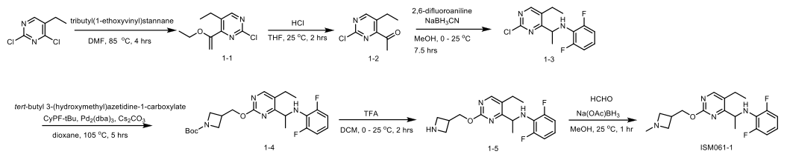

**Scheme S1** Preparation of ISM061-1

#### Step 1: Preparation of Compound 1-1

To a solution of 2,4-dichloro-5-ethylpyrimidine (5.00 g, 28.20 mmol) in DMF (50 mL) were added tributyl(1-ethoxyvinyl)stannane (11.22 g, 31.1 mmol) and bis (triphenylphosphine) palladium(II) chloride (0.99 g, 1.41 mmol). After the addition, the mixture was degassed and purged with N2 for 3 mins and then stirred at 85 ℃ for 4 hrs. After cooling to 20 ℃, The reaction solution was poured into water (50 mL) and extracted with EtOAc (50 mL × 3). The combined organic layers were washed with brine (50 mL × 2), dried over Na2SO4, filtered and concentrated under reduced pressure to give a residue, which was purified by flash silica gel chromatography (SiO2, ethyl acetate: petroleum ether = 0% - 10%) to afford the title compound (5.00 g, 83% yield) as colorless oil. LCMS(ESI): m/z 213.2 [M+H]+.

#### Step 2: Preparation of Compound 1-2

To a solution of 2-chloro-4-(1-ethoxyvinyl)-5-ethylpyrimidine (5.00 g, 23.51 mmol) in THF (50 mL) was added HCl (20 mL, 6 M) dropwise. After addition, the mixture was stirred at 25 ℃ for 2 hrs. The residue was adjusted pH = 9 ~ 10 with saturated Na2CO3 at 0 ℃ and extracted with EtOAc (25 mL × 3). The combined organic layers were washed with brine (40 mL × 2), dried over Na2SO4, filtered and concentrated under reduced pressure to give a residue, which was purified by flash silica gel chromatography (SiO2, ethyl acetate: petroleum ether = 0% - 10%) to afford the title compound (2.50 g, 58% yield) as colorless oil. LCMS (ESI): m/z 185.3 [M+H]+.

#### Step 3: Preparation of Compound 1-3

To a solution of 1-(2-chloro-5-ethylpyrimidin-4-yl)ethan-1-one (2.50 g, 13.54 mmol) in MeOH (50 mL) were added 2,6-difluoroaniline (2.10 g, 16.25 mmol) and AcOH (0.78 mL, 13.54 mmol). After addition, the mixture was stirred at 25 ℃ for 30 min. And then sodium cyanoborohydride (2.13 g, 33.9 mmol) was added at 0 ℃. The resulting mixture was stirred at 25 ℃ for 7 hrs. The reaction solution was poured into water (30 mL) and extracted with DCM (30 mL × 3). The combined organic layers were washed with brine (25 mL × 2), dried over Na2SO4, filtered and concentrated under reduced pressure to give a residue, which was purified by flash silica gel chromatography (SiO2,

<!-- PDF page 3 -->

ethyl acetate: petroleum ether = 0% - 7%) to afford the title compound (1.00 g, 25% yield) as yellow oil. LCMS (ESI): m/z 298.1 [M+H]+.

#### Step 4: Preparation of Compound 1-4

To a solution of N-(1-(2-chloro-5-ethylpyrimidin-4-yl)ethyl)-2,6-difluoroaniline (300.0 mg, 1.01 mmol) in 1,4-dioxane (4 mL) were added tert-butyl 3-(hydroxymethyl)azetidine-1-carboxylate (226.0 mg, 1.21 mmol), Cs2CO3 (985.0 mg, 3.02 mmol), CyPF-tBu (84.0 mg, 0.15 mmol) and Pd2(dba)3 (92.0 mg, 0.10 mmol). After addition, the mixture was degassed and purged with N2 for 2 mins and then stirred at 105 ℃ for 5 hrs under N2. After cooling to 20 ℃, the reaction solution was poured into water (50 mL) and extracted with EtOAc (40 mL × 3). The combined organic layers were washed with brine (20 mL × 2), dried over Na2SO4, filtered and concentrated under reduced pressure to give a residue, which was purified by flash silica gel chromatography (SiO2, ethyl acetate: petroleum ether = 0% - 22%) to afford the title compound (400 mg, 89.0% yield) as yellow oil. LCMS(ESI): m/z 449.3 [M+H]+.

#### Step 5: Preparation of Compound 1-5

To a solution of tert-butyl 3-(((4-(1-((2,6-difluorophenyl)amino)ethyl)-5-ethylpyrim idin-2-yl)oxy)methyl)azetidine-1-carboxylate (250.0 mg, 0.56 mmol) in DCM (2 mL) was added TFA (0.5 mL, 6.49 mmol) at 0 ℃. After addition, the mixture was stirred at 25 ℃ for 2 hrs. The reaction solution was concentrated under reduced pressure to afford the tittle compound (180.0 mg, 0.52 mmol), which was used in next step directly without further purification. LCMS(ESI): m/z 349.2 [M+H]+.

#### Step 6: Preparation of ISM061-1

To a solution of N-(1-(2-(azetidin-3-ylmethoxy)-5-ethylpyrimidin-4-yl)ethyl)-2,6-difluoroaniline (130.0 mg, 0.37 mmol) in MeOH (2 mL) were added formaldehyde (0.01 mL, 0.45 mmol) and sodium cyanoborohydride (46.9 mg, 0.75 mmol). After addition, the mixture was stirred at 25 ℃ for 1 hr. The reaction solution was poured into water (20 mL) and extracted with DCM (25 mL × 3). The combined organic layers were washed with brine (25 mL × 2), dried over Na2SO4, filtered and concentrated under reduced pressure to give a residue, which was purified by pre-HPLC (SHIMADZU, LC-20AP, Column: YMC Triart C18, 20 × 250 mm, 5 μm; Mobile phase: from 20 % to 31 % ACN [0.1% FA]; Flow rate: 15 mL/min; Retention Time: 15 min of 20 min) to afford the title compound (35.0 mg, 26% yield) as yellow oil. LCMS (ESI): m/z 363.3 [M+H]+; 1H NMR (400 MHz, DMSO-d6) δ 8.44 – 8.41 (m, 2H), 7.18 – 7.12 (m, 1H), 7.05 –7.01 (m, 2H), 4.63 – 4.58 (m,

<!-- PDF page 4 -->

1H), 4.46 – 4.36 (m, 2H), 3.99 – 3.94 (m, 2H), 3.77 – 3.67 (m, 2H), 3.22 – 3.15 (m, 1H), 2.79 (s, 3H), 2.50 – 2.47 (m, 2H), 1.44 – 1.42 (d, J = 8.0 Hz, 3H), 1.07 – 1.03 (t, J = 8.0 Hz, 3H).

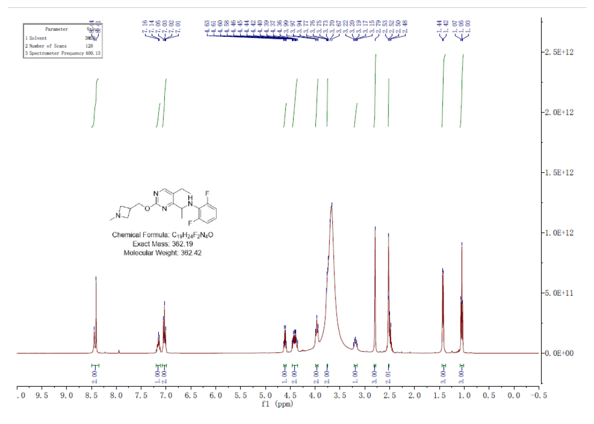

### S1.2. Preparation of ISM061-3-2

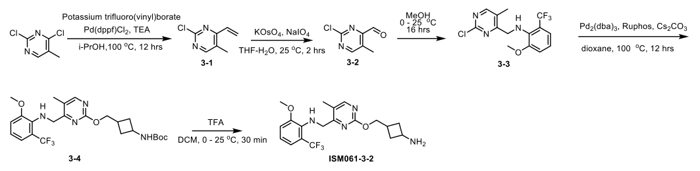

**Scheme S2** Preparation of ISM061-3-2

#### Step 1: Preparation of Compound 3-1

To a solution of 2,4-dichloro-5-methylpyrimidine (10.00 g, 61.30 mmol) in isopropyl alcohol (200 mL) were added potassium trifluoro(vinyl)borate (9.04 g, 67.50 mmol), TEA (8.55 mL, 61.3 mmol) and Pd(dppf)Cl2 (2.24 g, 3.07 mmol). The resulting mixture was stirred at 75 ℃ for 12 hrs under N2. After cooling to 20 ℃, the reaction solution was poured into water (40 mL) and extracted with EtOAc (50 mL × 3). The combined organic layers were washed with brine (50 mL × 2), dried over anhydrous Na2SO4, filtered and concentrated under reduced pressure to give a residue. The residue was purified

<!-- PDF page 5 -->

by column chromatography (SiO2, ethyl acetate: petroleum ether = 1: 100) to afford **Compound 3-1** (10.00 g, 78% yield) as yellow oil. LCMS (ESI+): 155.2 [M+H]+.

#### Step 2: Preparation of Compound 3-2

To a solution of 2-chloro-5-methyl-4-vinylpyrimidine (10.00 g, 64.70 mmol) in THF (200 ml) and water (200 mL) were added potassium osmate dihydrate (2.38 g, 6.47 mmol) and sodium periodate (41.50 g, 194.00 mmol). And then the mixture was stirred at 25 ℃ for 2 hrs. The reaction mixture was quenched by the addition of ice-water (200 mL) at 0 °C and extracted with EtOAc (200 mL × 3). The combined organic layers were washed with brine (250 mL × 2), dried over Na2SO4, filtered and concentrated under reduced pressure to give a residue. The residue was purified by column chromatography (SiO2, ethyl acetate: petroleum ether = 1: 100) to afford the **Compound 3-2** (2.50 g, 22% yield) as a gray solid. 1H NMR (400 MHz, Chloroform-d) δ 10.06 (s, 1H), 8.63 (s, 1H), 2.60 (s, 3H).

#### Step 3: Preparation of Compound 3-3

To a solution of 2-chloro-5-methylpyrimidine-4-carbaldehyde (500.0 mg, 3.19 mmol) in MeOH (10 mL) were added 2-methoxy-6-(trifluoromethyl)aniline (1.00 g, 5.23 mmol) and AcOH (0.03 mL, 0.52 mmol). After addition, the mixture was stirred at 25 ℃ for 12 hrs under N2. Then, sodium cyanoborohydride (973.0 mg, 15.69 mmol) was added at 0 ℃. The resulting mixture was stirred at 25 ℃ for 4 hrs. The reaction solution was poured into water (20 mL) and extracted with DCM (20 mL × 3). The combined organic layers were washed with brine (10 mL × 2), dried over Na2SO4, filtered and concentrated under reduced pressure to give a residue. The residue was purified by prep-TLC (SiO2, ethyl acetate: petroleum ether = 1: 5) to afford **Compound 3-3** (220.0 mg, 8% yield) as a white solid. LCMS (ESI+): 332.0 [M+H]+. 1H NMR (400 MHz, Chloroform-d) δ 8.33 (s, 1H), 7.19 - 7.16 (m, 1H), 7.03 - 7.01 (m, 1H), 6.96 - 6.92 (m, 1H), 4.50 - 4.49 (d, J = 4.0 Hz, 2H), 3.91 (s, 3H), 2.23 (s, 3H).

#### Step 4: Preparation of Compound 3-4

To a solution of **Compound 3-3** (220.0 mg, 0.66 mmol) in 1,4-dioxane (5 mL) were added *tert*-butyl (3-hydroxycyclobutyl)carbamate (124.0 mg, 0.66 mmol), Cs2CO3 (648.0 mg, 1.99 mmol), RuPhos (46.4 mg, 0.10 mmol) and Pd2(dba)3 (60.7 mg, 0.066 mmol). After addition, the mixture was stirred at 100 ℃ for 12 hrs under N2. After cooling to 20 ℃, the reaction solution was poured into water (20 mL) and extracted with EtOAc (20 mL × 3). The combined organic layers were washed with brine (20 mL × 2), dried over Na2SO4, filtered and concentrated under reduced pressure to give a residue.

<!-- PDF page 6 -->

The residue was purified by prep-TLC (SiO2, ethyl acetate: petroleum ether = 1: 3) to afford **Compound 3-4** (40.0 mg, 7% yield) as yellow oil. LCMS (ESI+): 497.2 [M+H]+.

#### Step 5: Preparation of ISM061-3-2

To a solution of **Compound 3-4** (35.0 mg, 0.07 mmol) in DCM (2 mL) was added TFA (0.1 mL, 1.30 mmol) dropwise at 0 ℃. After addition, the mixture was stirred at 25 ℃ for 30 min. The reaction mixture was concentrated under reduced pressure to give a residue, which was purified by pre-HPLC (SHIMADZU, LC-20AP, Column: YMC Triart C18, 20 × 250 mm, 5 μm; Mobile phase: from 25 % to 55 % ACN [0.1% NH3HCO3]; Flow rate: 15 mL/min; Retention Time: 25 min of 35 min) to afford **ISM061-3-2** (4.0 mg, 14% yield) as a white solid. LCMS(ESI+): 397.3 [M+H]+. 1H NMR (400 MHz, Chloroform-*d*) δ 8.22 (s, 1H), 7.17 (d, _J_ = 8.1 Hz, 1H), 7.02 (d, _J_ = 8.0 Hz, 1H), 6.90 (t, _J_ = 8.0 Hz, 1H), 6.03 – 5.77 (m, 1H), 4.49 (s, 2H), 4.40 – 4.33 (m, 2H), 3.90 (s, 3H), 3.53 – 3.43 (m, 1H), 2.56 – 2.44 (m, 3H), 2.15 (s, 3H), 1.84 – 1.80 (m, 2H).

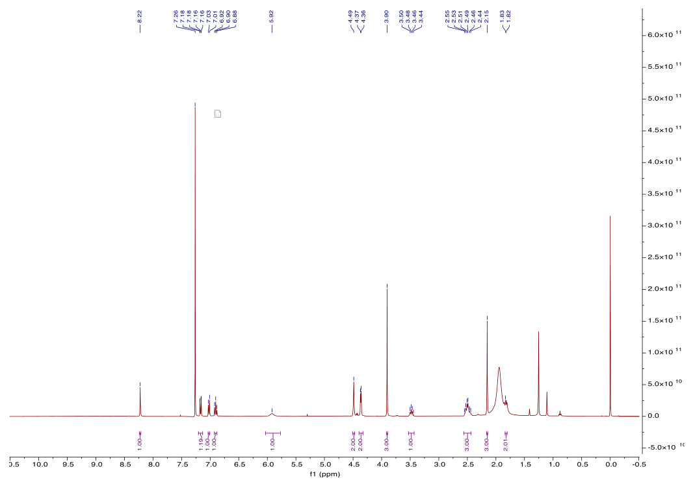

### S1.3. Preparation of ISM061-6

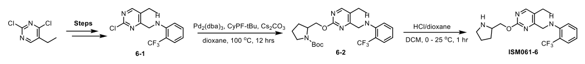

**Scheme S3** Preparation of ISM061-6

<!-- PDF page 7 -->

#### Step 1: Preparation of Compound 6-1

According to the preparation of **Compound 3-3**, **Compound 6-1** was synthesized with the corresponding substrates. LCMS(ESI+): 316.1 [M+H]+. 1H NMR (400 MHz, DMSO-d6) δ 8.62 (s, 1H), 7.50 - 7.43 (m, 2H), 6.92 - 6.90 (d, J = 8.0 Hz, 1H), 6.80 - 6.75 (m, 1H), 6.23 - 6.21 (m, 1H), 4.61 - 4.59 (d, J = 8 Hz, 2H), 2.79 - 2.73 (m, 2H), 1.25 - 1.21 (t, J = 8.0 Hz, 3H).

#### Step 2: Preparation of Compound 6-2

To a solution of N-((2-chloro-5-ethylpyrimidin-4-yl)methyl)-2-(trifluoromethyl) aniline (100.0 mg, 0.32 mmol) in 1,4-dioxane (2 mL) was added *tert*-butyl 2-(hydroxy methyl)pyrrolidine-1-carboxylate (127.0 mg, 0.63 mmol), Cs2CO3 (310.0 mg, 0.95 mmol), CyPF-tBu (35.1 mg, 0.06 mmol) and Pd2(dba)3 (29.0 mg, 0.03 mmol). After addition, the mixture was stirred at 100 ℃ for 12 hrs under N2. After cooling to 20 ℃, the reaction solution was poured into water (20 mL) and extracted with EtOAc (20 mL × 3). The combined organic layers were washed with brine (20 mL × 2), dried over Na2SO4, filtered and concentrated under reduced pressure to give a residue. The residue was purified by prep-TLC (SiO2, ethyl acetate: petroleum ether = 1: 4) to afford the title compound (40.0 mg, 26% yield) as colorless oil. LCMS(ESI+): 481.4 [M+H]+.

#### Step 3: Preparation of ISM061-6

To a solution of tert-butyl 2-(((5-ethyl-4-(((2-(trifluoromethyl)phenyl)amino)methyl) pyrimidin-2-yl)oxy)methyl)pyrrolidine-1-carboxylate (35.0 mg, 0.07 mmol) in DCM (5 mL) was added HCl-dioxane (0.5 mL, 2.00 mmol) at 0 ℃. After addition, the mixture was stirred at 25 ℃ for 1 hr. The reaction mixture was concentrated under reduced pressure to give a residue. The residue was purified by prep-TLC (SiO2, DCM: MeOH = 5: 1) to afford the title compound (12.3 mg, 44% yield) as a white solid. LCMS (ESI+): 381.3 [M+H]+. 1H NMR (400 MHz, DMSO-*d*6) δ 8.44 (s, 1H), 7.51 – 7.44 (m, 2H), 6.94 (d, _J_ = 8.4 Hz, 1H), 6.77 (t, _J_ = 7.5 Hz, 1H), 6.31 (t, _J_ = 4.7 Hz, 1H), 4.54 (d, _J_ = 4.5 Hz, 2H), 4.32 (dd, _J_ = 11.0, 4.7 Hz, 1H), 4.23 (dd, _J_ = 11.1, 8.0 Hz, 1H), 3.66 – 3.61 (m, 1H), 3.02 – 2.92 (m, 2H), 2.68 (q, _J_ = 7.6 Hz, 2H), 1.98 – 1.91 (m, 1H), 1.87 – 1.70 (m, 2H), 1.56 – 1.45 (m, 1H), 1.22 (t, _J_ = 7.5 Hz, 3H).

<!-- PDF page 8 -->

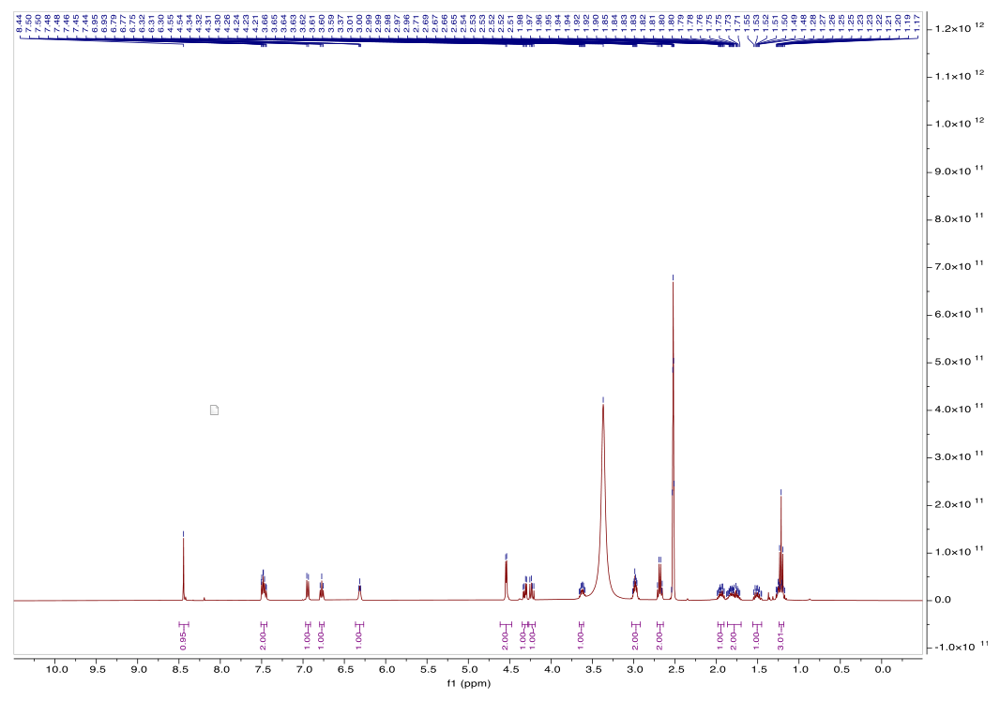

### S1.4. Preparation of ISM061-11

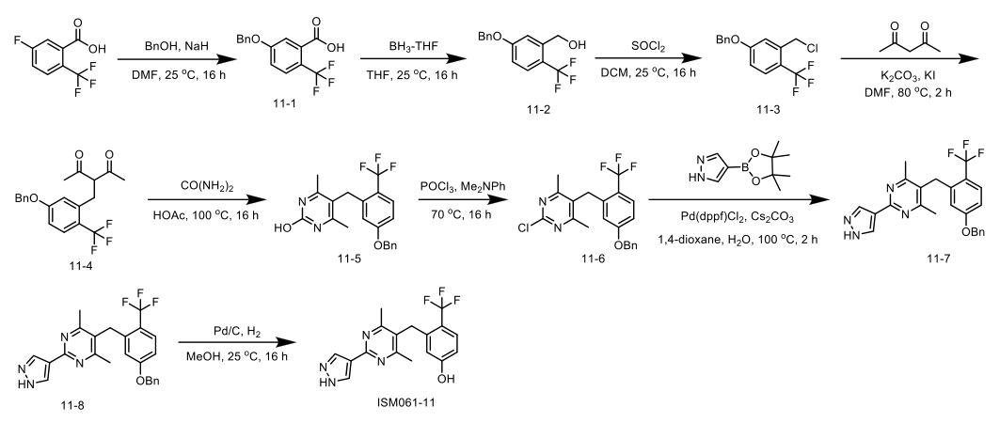

**Scheme S4** Preparation of ISM061-11

#### Step 1: Preparation of Compound 11-1

To a solution of 5-fluoro-2-trifluoromethylbenzoic acid (10.0 g, 48.1 mmol) in N,N-dimethylformamide (100 mL) was added sodium hydride (2.1 g, 53.0 mmol) in four batches under nitrogen protection at 0 °C. The mixture was stirred at 0 °C for 0.5 hr. After the addition of benzyl alcohol (5.7 g, 53.0 mmol) the reaction was stirred at 25 °C for 16 hours. The reaction was quenched with ice water (300 mL). The mixture was extracted with ethyl acetate (100 mL × 3), the combined the organic phases was washed with saturated brine (100 mL × 3), dried over anhydrous sodium sulfate, filtered, and concentrated under reduced pressure to afford the title compound (13.8 g, crude

<!-- PDF page 9 -->

product), which could be used to the next step without further purification. LCMS (ESI): 295.0 [M-H]-.

#### Step 2: Preparation of Compound 11-2

To a solution of **compound 11-1** (13.8 g, 46.6 mmol) in THF (140 mL) was added borane-tetrahydrofuran solution (14 mL, 139.8 mmol) under nitrogen protection dropwise at 0 °C. The mixture was stirred at 25 °C for 16 hours. The reaction was quenched by the addition of methanol (20 mL). After the addition of brine (80 mL), the mixture was extracted with ethyl acetate (100 mL × 3), the combined organic phases was washed with saturated brine (50 mL), dried over anhydrous sodium sulfate, filtered, and concentrated under reduced pressure to obtain the title compound (12.1 g, crude product) as a yellow solid, which could be used to the next step without further purification.

#### Step 3: Preparation of Compound 11-3

To a solution of **compound 11-2** (12.0 g, 42.6 mmol) in dichloromethane (120 mL) was added thionyl chloride (7.6 g, 63.9 mmol) dropwise at 0 °C. The resulting mixture was stirred at 25 °C for 16 hours. The mixture was concentrated under reduced pressure and further purified by silica gel column chromatography (EA:PE=1:10) to obtain the title compound as a yellow oil (9.9 g, total yield of the first three steps: 68.7%).

#### Step 4: Preparation of Compound 11-4

To a solution of **compound 11-3** (4.0 g, 13.3 mmol) in N,N-dimethylformamide (40 mL) was added acetylacetone (4.0 g, 39.9 mmol), potassium carbonate (5.5 g, 39.9 mmol) and potassium iodide (1.1 g, 6.7 mmol). The mixture was stirred at 80 °C for 2 hours. After the addition of ice water (100 mL) to quench the reaction, the mixture was extracted with ethyl acetate (50 mL × 3), the combined organic phases was washed with saturated brine water (40 mL × 3), dried over anhydrous sodium sulfate, filtered and concentrated under reduced pressure to obtain the title compound (1.3 g, crude product) as a yellow oil, which could be used to the next step without further purification. LCMS (ESI): 365.2 [M+H]+.

#### Step 5: Preparation of Compound 11-5

A mixture of compound **11-4** (1.2 g,3.3 mmol), sulfuric acid (0.1 mL) and urea(594 mg,9.9 mmol) in a ethanol (10 mL) was stirred at100°C for 16 hours. After the removal of ethanol, saturated sodium bicarbonate aqueous solution (50 mL) was added to the residue. The resulting mixture was extracted with ethyl acetate (30mL × 3). The combined organic phases was washed with saturated brine water (20mL × 2), dried over anhydrous sodium sulfate, filtered and concentrated under reduced pressure to afford a residue, which was purified by silica gel column chromatography (EA:PE=3:1) to give the title compound as a yellow solid (74 mg). LCMS (ESI): 389.2 [M+H]+.

<!-- PDF page 10 -->

#### Step 6: Preparation of Compound 11-6

To a solution of **compound 11-5** (361.0 mg, 0.9 mmol) in phosphorus oxychloride (4 mL) was added N,N-dimethylbenzylamine (254.0 mg, 2.1 mmol) at 0 °C. The mixture was stirred at 100 °C for 16 hours After the removal of phosphorus oxychloride under reduced pressure, the residue was dissolved in ethyl acetate (20 mL) and saturated sodium bicarbonate aqueous solution (10 mL). The mixture was extracted with ethyl acetate (20 mL × 3), the combined organic phases was dried over anhydrous sodium sulfate, filtered, and concentrated under reduced pressure to give the title compound as a white solid (240.0 mg, Y: 63.5%). LCMS (ESI): 407.3 [M+H]+.

#### Step 7: Preparation of Compound 11-7

To a solution of **compound 11-6** (230.0 mg, 566.5 µmol) in dioxane (20 mL) and water (4 mL) was added 4-pyrazoleboronic acid pinacol ester (220.0 mg, 1.1 mmol), cesium carbonate (359.0 mg, 1.1 mmol), [1,1’-bis(diphenylphosphino)ferrocene]dichloro palladium(II) dichloromethane complex (46.0 mg, 56.7 µmol). The mixture was stirred under nitrogen protection at 100 °C for 2 hours. After the addition of water (20 mL), the mixture was extracted with ethyl acetate (30 mL × 3). The combined organic phases was dried over anhydrous sodium sulfate, filtered, and concentrated under reduced pressure to afford a residue, which was further purified by silica gel column chromatography (EA:PE=1:2) to afford the title compound as a yellow solid (160 mg,Y: 64.5%). LCMS (ESI):439.2[M+H]+.

#### Step 8: Preparation of ISM061-11

A mixture of **compound 11-7** (100 mg) and Pd/C (50 mg, 10%) in methanol (10 mL) was stirred under H2 atmosphere at 25°C for 16 hours. Upon completion, the mixture was filtered, the filtrate was concentrated under reduced pressure to afford a residue, which was further purified by pre-HPLC to afford the title compound as a yellow solid (8 mg, Y: 10%). LCMS (ESI): 349.1 [M+H]+. 1H NMR (400 MHz, DMSO-*d*6) δ 13.09 (s, 1H), 10.02 (s, 1H), 8.29 – 7.93 (m, 2H), 7.54 (d, _J_ = 8.6 Hz, 1H), 6.69 (dd, _J_ = 8.6, 2.4 Hz, 1H), 6.13 (d, _J_ = 2.4 Hz, 1H), 4.05 (s, 2H), 2.29 (s, 6H).

<!-- PDF page 11 -->

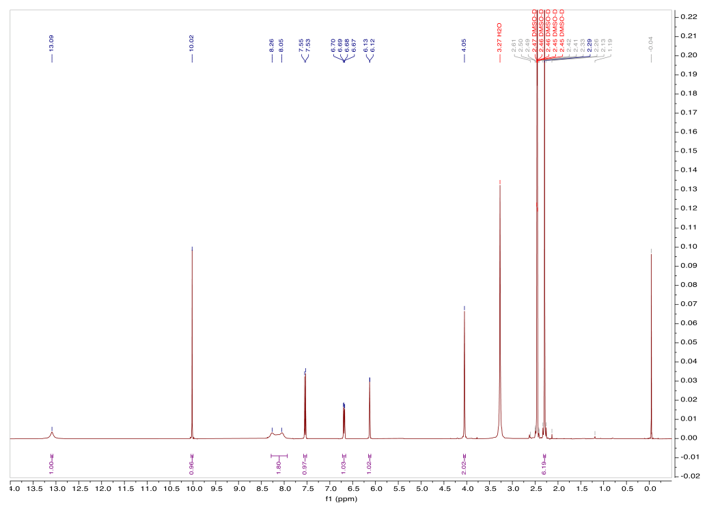

### S1.5. Preparation of ISM061-12

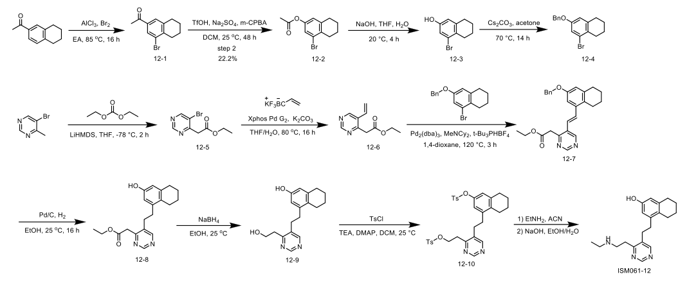

**Scheme S5** Preparation of ISM061-12

#### Step 1: Preparation of Compound 12-1

To a solution of 1-(5,6,7,8-tetrahydronaphthalen-2-yl)ethan-1-one (10.0 g, 57.5 mmol) in ethyl acetate (100 mL) was added aluminum chloride (19.1 g, 143.8 mmol) and bromine (11.0 g, 69.0 mmol). The resulting mixture was stirred at 85 °C for 16 hours. The reaction was quenched with ice water (100 mL). The resulting mixture was extracted with ethyl acetate (100 mL × 3). The combined organic phases was washed with saturated brine (50 mL × 3), dried over anhydrous sodium sulfate, filtered, and concentrated under reduced pressure to give the title compound as a yellow oil (5.1 g, Y: 35.2%). LCMS (ESI): 253.0 [M+H]+.

<!-- PDF page 12 -->

#### Step 2: Preparation of Compound 12-2

To a solution of **compound 12-1** (5.1 g, 20.2 mmol) in dichloromethane (50 mL) was added anhydrous sodium sulfate (2.9 g, 20.2 mmol), m-CPBA (8.7 g, 40.4 mmol) and trifluoromethanesulfonic acid (150.1 mg, 1.0 mmol). The resulting mixture was stirred at 25 °C for 48 hours. After the reaction is complete, quench the reaction solution with saturated sodium sulfite solution (10 mL). The mixture was then extracted with dichloromethane (50 mL × 3). The combined organic phases was washed with saturated brine water (20 mL), dried over anhydrous sodium sulfate, filtered and concentrated under reduced pressure to obtain the title compound as a yellow solid (1.2 g,Y: 22.2%).

#### Step 3: Preparation of Compound 12-3

To a solution of **compound 12-2** (500 mg, 1.9 mmol) in THF (6 mL) was added water (1 mL) and sodium hydroxide (152 mg, 3.8 mmol). The resulting mixture was stirred at20°C for 4 hours. After the reaction was completed, dilute the reaction solution with water (10 mL). The mixture was then extracted with ethyl acetate (200 mL × 3). The combined organic phases was washed with saturated brine water (10 mL), dried over anhydrous sodium sulfate, filtered, and concentrated under reduced pressure to give a residue, which was further purified by silica gel column chromatography (EA:PE=1:10) to afford the title compound as a yellow solid (310 mg, Y: 73.5%). LCMS (ESI): 227.1 [M+H]+.

#### Step 4: Preparation of Compound 12-4

To a solution of **compound 12-3** (280 mg, 1.2 mmol) in acetone (18 mL) was added cesium carbonate (782 mg,2.4 mmol) and BnBr (205.2 mg, 1.2 mmol). The resulting mixture was stirred at 70°C for 14 hours. Upon completion, the mixture was concentrated under reduced pressure to give a residue, which was purified by silica gel column chromatography (EA:PE=1:10) to afford the title compound as a yellow oil (200 mg, Y: 51%).

#### Step 5: Preparation of Compound 12-5

To a solution of 5-bromo-4-methylpyrimidine (2 g,11.6 mmol) in tetrahydrofuran (40 mL) was added LiHMDS (17 mL,17 mmol, 1M in THF) dropwise at -70°C under nitrogen. The resulting mixture was stirred at -70°C for 1 hour. Then diethyl carbonate (1 g, 7 mmol) was added. The mixture was stirred at room temperature for 16 hours. Upon completion, pour the reaction solution into ice water (10 mL), the resulting mixture was extracted with ethyl acetate (50 mL × 3). The combined organic phases was washed with brine (10 mL), dried over anhydrous sodium sulfate, filtered, and concentrated under reduced pressure to afford a residue, which was purified by silica gel column

<!-- PDF page 13 -->

chromatography (EA:PE=5:1) to give the title compound as a yellow oil (1 g, Y: 57%). LCMS (ESI): 245.1 [M+H]+.

#### Step 6: Preparation of Compound 12-6

To a solution of **compound 12-5** (320 mg, 1.3 mmol) in THF (16 mL) was added triethylamine (486 mg, 4.8 mmol), 4-dimethylaminopyridine (37 mg, 0.3 mmol) and p-toluenesulfonyl chloride (664 mg, 3 mmol). The resulting mixture was stirred under nitrogen protection at 20°C for 2 hours. After the addition of ice water (10 mL), the mixture was extracted with dichloromethane (20 mL × 3). The combined organic phases was washed with brine (10 mL), dried over anhydrous sodium sulfate, filtered, and concentrated under reduced pressure to give a residue, which was further purified by silica gel column chromatography (EA:PE=1:5) to afford the title compound as a yellow oil (203 mg, Y: 80%). LCMS (ESI): 193.1 [M+H]+.

#### Step 7: Preparation of Compound 12-7

To a solution of compound **12-6** (183 mg, 1 mmol) in 1,4-dioxane (8 mL) was added **compound 12-4** (474 mg, 1.5 mmol), Pd2(dba)3 (91.5 mg,0.1 mmol), N-methyldicyclohexylamine (585 mg, 3 mmol) and trifluoroborane tri-*tert*-butylphosphine (58 mg, 0.2 mmol). The mixture was stirred at 120°C under N2 for 3 hours. After the addition of ice water (10 mL), the mixture was extracted with ethyl acetate (20 mL × 3). The combined organic phases was washed with brine (10 mL), dried over anhydrous sodium sulfate, filtered, and concentrated under reduced pressure to give a residue, which was further purified by silica gel column chromatography (EA:PE=1:2) to afford the title compound as a yellow solid (254 mg, Y: 62%). LCMS (ESI): 429.3 [M+H]+.

#### Step 8: Preparation of Compound 12-8

A mixture of **compound 12-7** (1.3 g,3 mmol) and Pd/C (120 mg) in ethanol(10 mL) was stirred under hydrogen at 20°C for 16 hours. Upon completion, the mixture was filtered, and concentrated under reduced pressure to give a residue, which was further purified by silica gel column chromatography (EA:PE=2:1) to afford the title compound (920 mg, Y: 90%). LCMS (ESI): 341.2 [M+H]+.

#### Step 9: Preparation of Compound 12-9

A mixture of **compound 12-8** (920 mg,2.7 mmol) and NaBH4 (1 g, 27 mmol) in ethanol (10 mL) was stirred at 20°C for 14 hours. After the addition of ice water (10 mL), the mixture was extracted with ethyl acetate (30 mL × 3). The combined organic phases was washed with brine (10 mL), dried over anhydrous sodium sulfate, filtered, and concentrated under reduced pressure to give a residue, which was further purified by silica gel column chromatography (EA:PE=2:1) to afford the title compound (410 mg, Y: 50%). LCMS (ESI): 299.2 [M+H]+.

#### Step 10: Preparation of Compound 12-10

<!-- PDF page 14 -->

To a solution of **compound 12-9** (410 mg,1.4 mmol) in dichloromethane (10 mL) was added triethylamine (486 mg,4.8 mmol), 4-dimethylaminopyridine (37 mg,0.3 mmol) and p-toluenesulfonyl chloride (664 mg,3 µmol). The mixture was stirred at 20 °C under N2 for 2 hours. After the addition of ice water (10 mL), the mixture was extracted with dichloromethane (20 mL × 3). The combined organic phases was washed with brine (10 mL), dried over anhydrous sodium sulfate, filtered, and concentrated under reduced pressure to give a residue, which was further purified by silica gel column chromatography to afford the title compound (120 mg, Y:14.5%).

#### Step 11: Preparation of ISM061-12

A solution of **compound 12-10** (120 mg,0.2 mmol) in ethylamine (5 mL, 1M in THF) was stirred at 25 °C for 16 hours. The mixture was concentrated to give crude produce, which was dissolved in ethanol (2 mL) and water (0.3 mL), and then NaOH (12 mg, 0.3 mmol) was added. The reaction was stirred at 25 °C for 4 hours. The pH is adjusted to 6-7 with 1N hydrochloric acid. The solution is directly purified by HPLC to afford the title compound as a white solid (5.7 mg, Y: 8.9%). LCMS (ESI): 326.2 [M+H]+. 1H NMR (400 MHz, Methanol-d4) δ 7.93 (s, 1H), 6.49 (s, 1H), 5.74 (s, 1H), 3.21 – 3.07 (m, 4H), 2.93 – 2.84 (m, 2H), 2.75 (td, _J_ = 14.5, 7.0 Hz, 2H), 2.66 (t, _J_ = 6.0 Hz, 2H), 2.59 – 2.38 (m, 3H), 2.19 – 2.08 (m, 1H), 1.93 – 1.84 (m, 1H), 1.83 – 1.71 (m, 1H), 1.69 – 1.60 (m, 2H), 1.34 (t, _J_ = 7.3 Hz, 3H).

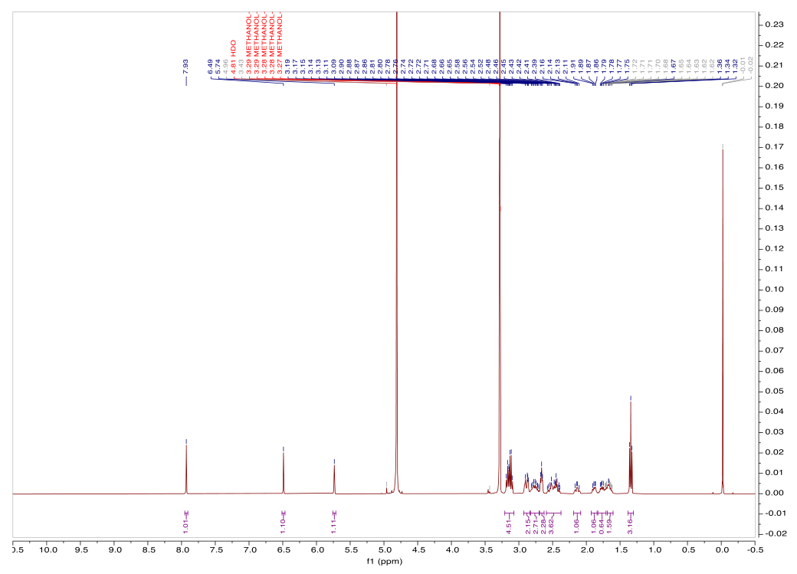

<!-- PDF page 15 -->

### S1.6. Preparation of ISM061-13

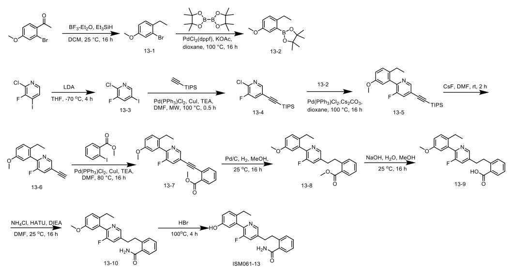

**Scheme S6** Preparation of ISM061-13

#### Step 1: Preparation of Compound 13-1

To a solution of 3-bromo-4-ethylphenol (1.0 g, 4.4 mmol) in dichloromethane (10 mL) was added boron trifluoride etherate (6.6 ml, 6.6 mmol) and triethylsilane (0.8 g, 6.6 mmol) under nitrogen protection at 0 °C. The mixture was stirred at 25 °C for 16 hours. After the addition of ice water (50 mL), the mixture was extracted with dichloromethane (50 mL × 3). The combined organic phases was washed with brine (10 mL), dried over anhydrous sodium sulfate, filtered, and concentrated under reduced pressure to give a residue, which was further purified by silica gel column chromatography to afford the title compound as a yellow oil (900 mg, Y: 95.9%).

#### Step 2: Preparation of Compound 13-2

To a solution of **compound 13-1** (900 mg, 4.2 mmol) in dioxane (9 mL) was added [1,1’-bis(diphenylphosphino)ferrocene]dichloro palladium (II) (160 mg, 0.29 mmol), potassium acetate (1.2 g, 12.6 mmol) and B2(pin)2 (1.6 mg, 6.3 mmol). The mixture was stirred at 100 °C for 16 hours. The mixture was then concentrated under reduced pressure to give a residue, which was further purified by silica gel column chromatography (PE:EA=50:1) to afford the title compound as a yellow oil (810 mg, Y: 73.6%). 1H NMR (400 MHz, DMSO-d6) δ 7.10 - 7.06 (m, 2H), 6.91 - 6.87 (m, 1H), 3.67 (s, 1H), 2.74 - 2.68 (m, 2H), 1.25 (s, 12H), 1.06 - 1.02 (m, 3H).

#### Step 3: Preparation of Compound 13-3

To a solution of 2-chloro-3-fluoro-4-iodopyridine (3.5 g, 13.6 mmol) in THF (35 mL) was added LiHMDS (6.8 ml,13.6 mmol) under nitrogen at –70°C. The mixture was stirred at this temperature for another 4 hours. The reaction solution was poured into saturated ammonium chloride (50 mL).

<!-- PDF page 16 -->

The resulting mixture was extracted with ethyl acetate (20 mL × 3). The combined organic phases was washed with brine (10 mL), dried over anhydrous sodium sulfate, filtered, and concentrated under reduced pressure to give a residue, which was further purified by silica gel column chromatography to afford the title compound (820 mg, Y: 23%). 1H NMR (400 MHz, DMSO-d6) δ 8.42 (s, 1H), 7.79 (s, 1H).

#### Step 4: Preparation of Compound 13-4

To a solution of **compound 13-3** (800 mg, 3.1 mmol) in DMF (3 mL) was added triethylamine (327 mg, 3.2 mmol), copper iodide (20 mg, 0.1 mmol), 2-iodobenzoic acid methyl ester (254 mg, 1 mmol) and bis(triphenylphosphine)dichloro palladium (II) (70 mg, 0.1 mmol) under nitrogen. The mixture was stirred at 80°C for 16 hours. The reaction mixture was concentrated under reduced pressure to give a residue, which was purified by silica gel column chromatography (PE:EA=50:1) to afford the title compound as a yellow oil (900 mg, Y: 47%).

#### Step 5: Preparation of Compound 13-5

To a solution of **compound 13-4** in dioxane (5 mL) was added Cs2CO3 (2.73 g, 8.9 mmol), **compound 13-2** (1.12 g, 4.3 mmol) and Pd(PPh3)Cl2 (211 mg, 0.3 mmol). The mixture was stirred at 100 °C for 16 hrs. The mixture was then concentrated under reduce pressure to give a residue, which was further purified by silica gel column chromatography to afford the title compound as a yellow oil (500 mg, Y: 42%). LCMS (ESI): 412.2 [M+H]+.

#### Step 6: Preparation of Compound 13-6

To a solution of **compound 13-5** (500 mg, 1.2 mmol) in N,N-dimethylformamide (5 mL), CsF (1.8 g, 12.0 mmol) was added under nitrogen. The resulting mixture was stirred at room temperature for 12 hrs. After the addition of ice water (50 mL), the mixture was extracted with EA (20 mL × 3). The combined organic phases was washed with brine (20 mL), dried over anhydrous sodium sulfate, filtered, and concentrated under reduced pressure to give a residue, which was further purified by silica gel column chromatography to afford the title compound as a yellow oil (165 mg, Y: 51%). LCMS (ESI): 256.1 [M+H]+.

#### Step 7: Preparation of Compound 13-7

According to a similar procedure of **step 4**, the title compound was obtained as a yellow oil (51.8 mg, Y: 21.8%).

#### Step 8: Preparation of Compound 13-8

According to a similar procedure with **step 8** in compound **ISM061-12**, the title compound was obtained as a yellow oil (50 mg, Y: 96.4%). LCMS (ESI): 394.2 [M+H]+.

#### Step 9: Preparation of Compound 13-9

<!-- PDF page 17 -->

A mixture of **compound 13-8** (50 mg, 0.13 mmol) and NaOH (10 mg，0.26 mmol) in MeOH (1 mL) and water (2 ml) was stirred at room temperature for 16 hrs. Upon completion, the reaction mixture was poured into ice water (10 mL), the pH was adjusted to 6 with 2 M HCl. The mixture was then extracted with EA (10 mL × 3). The combined organic phases was washed with brine (20 mL), dried over anhydrous sodium sulfate, filtered, and concentrated under reduced pressure to afford the crude title compound as a white solid (48.2 mg, Y: 99.2%).

#### Step 10: Preparation of Compound 13-10

To a solution of **compound 13-9** (41 mg, 0.11 mmol) in N,N-dimethylformamide (2 mL) was added ammonium chloride (9 mg, 0.16 mmol), N,N-diisopropylethylamine (43 mg, 0.33 mmol) and 2-(7-azo-biphenyltriazole)-N,N,N’,N’-tetramethylurea hexafluorophosphate (61 mg, 0.16 mmol). The resulting mixture was stirred at 25 °C for 16 hours. After the addition of ice water (10 mL), the mixture was extracted with ethyl acetate (10 mL × 3). The combined organic phases was washed with brine (20 mL), dried over anhydrous sodium sulfate, filtered, and concentrated under reduced pressure to give a residue, which was further purified by silica gel column chromatography to afford the title compound (31.0 mg, Y: 75.2%). LCMS (ESI): 379.2 [M+H]+.

#### Step 11: Preparation of ISM061-13

A solution of **compound 13-10** (31 mg, 0.08 mmol) in hydrobromic acid aqueous solution (3 mL) was stirred at 100 °C for 4 hours. After the addition of ice water (10 mL), the mixture was extracted with ethyl acetate (10 mL × 3). The combined organic phases was washed with brine (20 mL), dried over anhydrous sodium sulfate, filtered, and concentrated under reduced pressure to give a residue, which was purified by pre-HPLC to afford the title compound as a white solid (12.4 mg, Y: 41.7%). LC-MS (ESI): 365 [M+H]+; 1H NMR (400 MHz, DMSO-d6) δ 9.28 (s, 1H), 8.28 – 8.23 (m, 1H), 7.79 (s, 1H), 7.58 (dd, _J_ = 10.7, 1.7 Hz, 1H), 7.41 – 7.32 (m, 2H), 7.28 (td, _J_ = 7.4, 1.6 Hz, 1H), 7.25 – 7.15 (m, 2H), 7.09 (d, _J_ = 8.4 Hz, 1H), 6.75 (dd, _J_ = 8.3, 2.7 Hz, 1H), 6.59 (dd, _J_ = 2.7, 0.9 Hz, 1H), 3.06 (dd, _J_ = 9.7, 5.9 Hz, 2H), 2.94 (dd, _J_ = 9.7, 6.0 Hz, 2H), 2.31 (q, _J_ = 7.5 Hz, 2H), 1.20 (s, 0H), 0.89 (t, _J_ = 7.5 Hz, 3H).

<!-- PDF page 18 -->

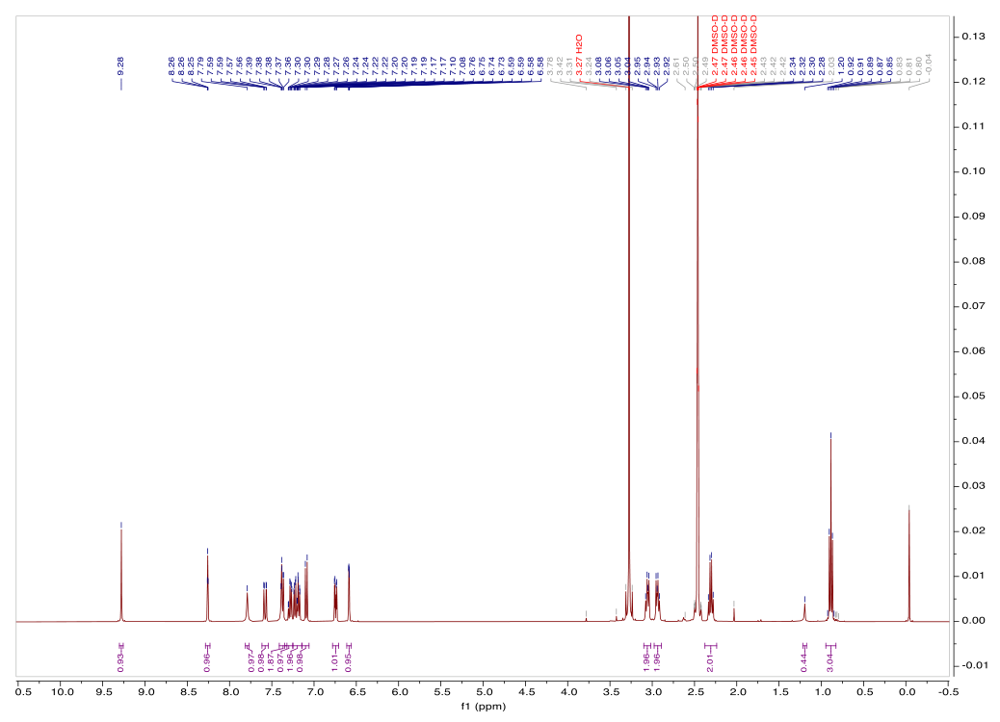

### S1.7. Preparation of ISM061-14

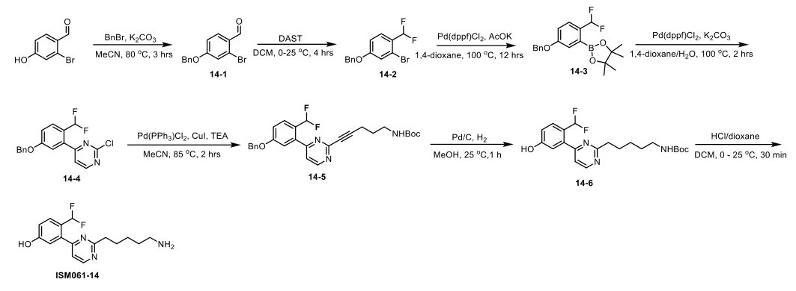

**Scheme S7** Preparation of ISM061-14

#### Step 1: Preparation of Compound 14-1

To a solution of 2-bromo-4-hydroxybenzaldehyde (1.00 g, 4.98 mmol) and (bromomethyl)benzene (0.7 mL, 5.97 mmol) in MeCN (10 mL) was added K2CO3 (2.06 g, 14.93 mmol). After addition, then the mixture was stirred at 80 ℃ for 3 hrs. After cooling to 20 ℃, the reaction solution was poured into water (50 mL) and extracted with EtOAc (25 mL × 3). The combined organic layers were washed with brine (25 mL × 2), dried over Na2SO4, filtered and concentrated under reduced pressure to give a residue. The residue was purified by flash silica gel chromatography (SiO2, ethyl acetate: petroleum

<!-- PDF page 19 -->

ether = 0% - 10%) to afford **Compound 14-1** (1.20 g, 83% yield) as a white solid. LCMS (ESI+): 291.2 [M+H]+.

#### Step 2: Preparation of Compound 14-2

To a solution of 4-(benzyloxy)-2-bromobenzaldehyde (100.0 mg, 0.34 mmol) in DCM (5 mL) was added DAST (0.2 mL, 1.72 mmol) dropwise at 0 ℃ and then the mixture was stirred at 25 ℃ for 4 hrs. After cooling to 0 ℃, the reaction mixture was quenched by ice-water (20 mL) and extracted with EtOAc (25 mL × 3). The combined organic layers were washed with brine (25 mL × 2), dried over Na2SO4, filtered and concentrated under reduced pressure to give a residue. The residue was purified by prep-TLC (SiO2, ethyl acetate: petroleum ether = 5: 1) to afford **Compound 14-2** (90.0 mg, 84% yield) as colorless oil. 1H NMR (400 MHz, Methanol-d4) δ 7.55 - 7.53 (d, J = 8.0 Hz, 1H), 7.43 - 7.29 (m, 5H), 7.27 (s, 1H), 7.09 - 7.06 (m, 1H), 7.03 - 6.75 (t, J = 56 Hz, 1H), 5.09 (s, 2H).

#### Step 3 & 4: Preparation of Compound 14-4

To a solution of 4-(benzyloxy)-2-bromo-1-(difluoromethyl)benzene (200.0 mg, 0.64 mmol) in 1,4-dioxane (5 mL) were added bis(pinacolato)diboron (194.6 mg, 0.77 mmol), potassium acetate (188.0 mg, 1.92 mmol) and Pd(dppf)Cl2 (46.7 mg, 0.06 mmol). After addition, the mixture was purged with N2 for 2 mins and then stirred at 100 ℃ for 12 hrs under N2. After cooling to 25 ℃, water (1 mL) was added followed by K2CO3 (230.2 mg, 1.67 mmol), 2,4-dichloropyrimidine (95.3 mg, 0.64 mmol) and Pd(dppf)Cl2 (40.6 mg, 0.06 mmol). The mixture was stirred at 100 ℃ under N2 for 2 hrs. After cooling to 20 ℃, the reaction solution was poured into water (40 mL) and extracted with EtOAc (20 mL × 3). The combined organic layers were washed with brine (20 mL × 2), dried over Na2SO4, filtered and concentrated under reduced pressure to give a residue. The residue was purified by flash silica gel chromatography (SiO2, ethyl acetate: petroleum ether = 0% - 10%) to afford **Compound 14-4** (150.0 mg, 78% yield) as colorless oil. LCMS (ESI+): 347.2 [M+H]+. 1H NMR (400 MHz, Methanol-d4) δ 8.77 - 8.76 (d, J = 4.0 Hz, 1H), 7.76 - 7.73 (m, 1H), 7.69 - 7.67 (d, J = 4.0 Hz, 1H), 7.48 - 7.45 (m, 2H), 7.40 - 7.29 (m, 6H), 5.20 (s, 2H).

#### Step 5: Preparation of Compound 14-5

To a solution of 4-(5-(benzyloxy)-2-(difluoromethyl)phenyl)-2-chloropyrimidine (150.0 mg, 0.43 mmol) in MeCN (3 ml) were added _tert_-butyl pent-4-yn-1-ylcarbamate (95.0 mg, 0.52 mmol), copper(I) iodide (16.48 mg, 0.09 mmol), TEA (0.18 ml, 1.30 mmol) and Pd(PPh)3Cl2 (30.4 mg, 0.043 mmol). After addition, the mixture was purged with N2 for 2 mins and then stirred at 85 ℃ for 12 hrs under N2. After cooling to 20 ℃, the reaction solution was poured into water (20 mL) and extracted with EtOAc (20 mL × 3). The combined organic layers were washed with brine (20 mL × 2), dried

<!-- PDF page 20 -->

over Na2SO4, filtered and concentrated under reduced pressure to give a residue. The residue was purified by flash silica gel chromatography (SiO2, ethyl acetate: petroleum ether = 0% - 30%) to afford **Compound 14-5** (100 mg, 47% yield) as yellow oil. LCMS (ESI+): Rt=2.092 min; m/z 494.3 [M+H]+.

#### Step 6: Preparation of Compound 14-6

To a solution of _tert_-butyl (5-(4-(5-(benzyloxy)-2-(difluoromethyl)phenyl)pyrimidin-2-yl)pent-4-yn-1-yl)carbamate (100.0 mg, 0.20 mmol) and Pd/C (10.0 mg, 9.40 µmol) in MeOH (5 ml) was degassed and purged with H2 for 3 times and the reaction was stirred at 25 ℃ for 1 hr under H2 atmosphere (15Psi). The reaction mixture was filtered through a celite and the filter cake was rinsed with a small amount of MeOH (20 mL). The combined organic layers were concentrated under reduced pressure to afford **Compound 14-6** (80.0 mg), which was used in next step directly without further purification. LCMS (ESI+): 408.3 [M+H]+.

#### Step 7: Preparation of ISM061-14

To a solution of tert-butyl (5-(4-(2-(difluoromethyl)-5-hydroxyphenyl)pyrimidin-2-yl)pentyl)carbamate (100.0 mg, 0.25 mmol) in DCM (5 mL) was added HCl-dioxane (1 mL, 4 M) at 0 ℃, and then the mixture was stirred at 25 ℃ for 30 min. The mixture was concentrated under reduced pressure to give a residue, which was purified by pre-HPLC (SHIMADZU, LC-20AP, Column: YMC Triart C18, 20 × 250 mm, 5 μm; Mobile phase: from 5% to 35% ACN [0.1% HCl]; Flow rate: 15 mL/min; Retention Time:17 min of 30 min) to afford the title compound (35.0 mg, 0.10 mmol, 42% yield) as a gray solid. LCMS(ESI+): 308.1 [M+H]+. 1H NMR (400 MHz, DMSO-d6) δ 11.17 – 9.67 (m, 1H), 8.86 (d, _J_ = 5.2 Hz, 1H), 7.91 (s, 2H), 7.64 (d, _J_ = 9.2 Hz, 1H), 7.61 (d, _J_ = 5.2 Hz, 1H), 7.29 (t, _J_ = 55.7 Hz, 1H), 7.11 – 7.05 (m, 2H), 2.96 (t, _J_ = 7.6 Hz, 2H), 2.78 (dq, _J_ = 11.7, 6.0 Hz, 2H), 1.83 (p, _J_ = 7.6 Hz, 2H), 1.63 (q, _J_ = 7.6 Hz, 2H), 1.44 – 1.36 (m, 2H).

<!-- PDF page 21 -->

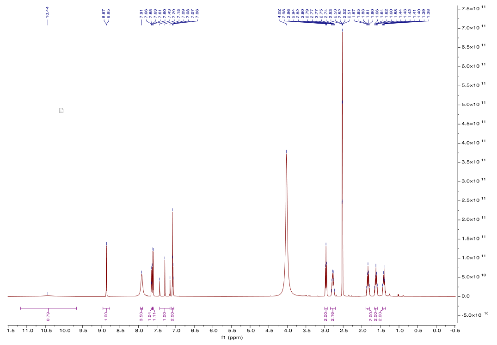

### S1.8. Preparation of ISM061-15

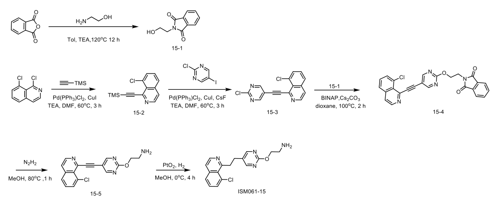

**Scheme S8** Preparation of ISM061-15

#### Step 1: Preparation of Compound 15-1

To a solution of 2-aminoethan-1-ol (2 g, 32.73 mmol) in PhMe (20 mL) were added DIEA (12.7 g, 98.2 mmol) and isobenzofuran-1,3-dione (4.8 g, 32.73 mmol) at N2 atmosphere. Then the mixture was heated and stirred at 120 ℃ for 3 h. After cooling to 25 ℃, the reaction mixture was poured into ice water (60 mL) and extracted with EtOAc (40 mL × 3), the combined organic layers were washed with brine (50 mL × 3), dried over Na2SO4, filtered and concentrated under reduced pressure to give a residue, which was purified by column chromatography on silica gel eluting with ethyl acetate (from

<!-- PDF page 22 -->

0% to 50%) in petroleum ether to afford **Compound 15-1** (4 g, 63.9 % yield) as a white solid. LCMS (ESI+): 192.3 [M+H]+.

#### Step 2: Preparation of Compound 15-2

To a solution of 1,8-dichloroisoquinoline (1000 mg, 5.05 mmol) in DMF (8 mL) were added TEA (2044 mg, 20.202 mmol), CuI (192 mg, 1.01 mmol), Pd(pph3)2Cl2 (709 mg, 1.01 mmol) and ethynyltrimethylsilane (2480 mg, 25.25 mmol) at N2 atmosphere. Then the mixture was heated and stirred at 60 ℃ for 3 h. After cooling to 25 ℃, the reaction mixture was poured into ice water (60 mL) and extracted with EtOAc (40 mL × 3), the combined organic layers were washed with brine (50 mL × 3), dried over Na2SO4, filtered and concentrated under reduced pressure to give a residue, which was purified by column chromatography on silica gel, eluting with ethyl acetate (from 0% to 30%) in petroleum ether, to afford **Compound 15-2** (1050 mg, 80 % yield) as a yellow oil. LCMS (ESI+): 260.3 [M+H]+.

#### Step 3: Preparation of Compound 15-3

To a solution of 2-chloro-5-iodopyrimidine (500 mg,2.08 mmol) in DMF (8 mL) were added TEA (1050 mg, 10.40 mmol), CuI (119 mg, 0.62 mmol), Pd(pph3)2Cl2 (292 mg, 0.42 mmol) , Cesium fluoride (632 mg, 4.16 mmol) and 8-chloro-1-((trimethylsilyl)ethynyl)isoquinoline (476 mg, 1.83 mmol) at N2 atmosphere. Then the mixture was heated and stirred at 60 ℃ for 12 h. After cooling to 25 ℃, the reaction mixture was poured into ice water (40 mL) and extracted with EtOAc (30 mL × 3), the combined organic layers were washed with brine (30 mL × 3), dried over Na2SO4, filtered and concentrated under reduced pressure to give a residue, which was purified by column chromatography on silica gel, eluting with ethyl acetate (from 0% to 100%) in petroleum ether, to afford **Compound 15-3** (400 mg, 64.1% yield) as a yellow solid. LCMS (ESI+): 300.1 [M+H]+.

#### Step 4: Preparation of Compound 15-4

To a solution of 8-chloro-1-((2-chloropyrimidin-5-yl)ethynyl)isoquinoline (400 mg, 1.33 mmol) in dioxane (5 mL) were added Cs2CO3 (869 mg, 2.66 mmol), BINAP (166 mg, 0.27 mmol), Pd(dba)3 (108 mg, 0.13 mmol) and 2-(2-hydroxyethyl)isoindoline-1,3-dione (306 mg, 1.60 mmol) at N2 atmosphere. Then the mixture was heated and stirred at 100 ℃ for 2 h. After cooling to 25 ℃, the reaction mixture was poured into ice water (40 mL) and extracted with EtOAc (30 mL × 3), the combined organic layers were washed with brine (50 mL), dried over Na2SO4, filtered and concentrated under reduced pressure to give a residue, which was purified by column chromatography on silica gel, eluting with ethyl acetate (from 0% to 100%) in petroleum ether, to afford **Compound 15-4** (400 mg, 66.0% yield) as a yellow solid. LCMS (ESI+): 455.0 [M+H]+.

<!-- PDF page 23 -->

#### Step 5: Preparation of Compound 15-5

To a solution of 2-(2-((5-((8-chloroisoquinolin-1-yl)ethynyl)pyrimidin-2-yl)oxy)ethyl)isoindoline-1,3-dione (400 mg, 0.83 mmol) in MeOH (5 mL) were added Hydrazinium hydroxide solution (2 mL, 1.76 mmol). Then the mixture was heated and stirred at 80 ℃ for 30 min. After cooling to 25 ℃, the reaction mixture was poured into ice water (40 mL) and extracted with EtOAc (30 mL × 3), the combined organic layers were washed with brine (30 mL), dried over Na2SO4, filtered and concentrated under reduced pressure to afford **Compound 15-5** (260 mg, 91.0% yield) as a yellow solid. LCMS (ESI+): 325.2 [M+H]+.

#### Step 6: Preparation of ISM061-15

To a solution of 2-((5-((8-chloroisoquinolin-1-yl)ethynyl)pyrimidin-2-yl)oxy)ethan-1-amine (150 mg, 0.46 mmol) in MeOH (5 mL) was added Platinum dioxide (21 mg, 0.1 mmol). The reaction mixture was stirred at H2 at 25 ℃ for 4 h, the mixture was filtered and the filtrate was concentrated to give the crude product, which was further purified by Prep-HPLC (column: YMC, C18 (250 × 20mm, 5 μm); mobile phase: [water (0.1%NH4OH) - ACN]; B%: 20ACN% - 50ACN%, 20 min) to afford the title compound (11 mg, 7.2% yield). LCMS (ESI+): 329.0 [M+H]+; 1H NMR (400 MHz, DMSO-d6) δ 8.47 (d, _J_ = 5.5 Hz, 1H), 8.18 (s, 2H), 7.98 (dd, _J_ = 8.1, 1.3 Hz, 1H), 7.86 – 7.77 (m, 2H), 7.70 (t, _J_ = 7.8 Hz, 1H), 6.78 (t, _J_ = 5.8 Hz, 1H), 4.66 (t, _J_ = 5.6 Hz, 1H), 3.96 – 3.78 (m, 2H), 3.51 – 3.47 (m, 2H), 3.31 – 3.29 (m, 2H), 3.00 – 2.84 (m, 2H).

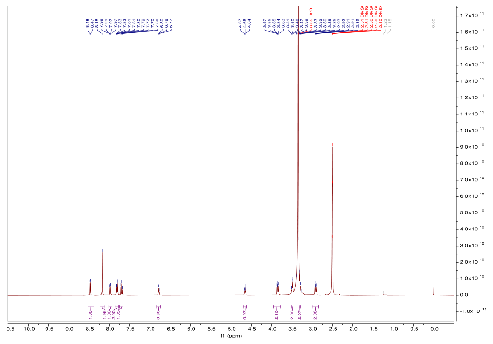

<!-- PDF page 24 -->

### S1.9. Preparation of ISM061-16

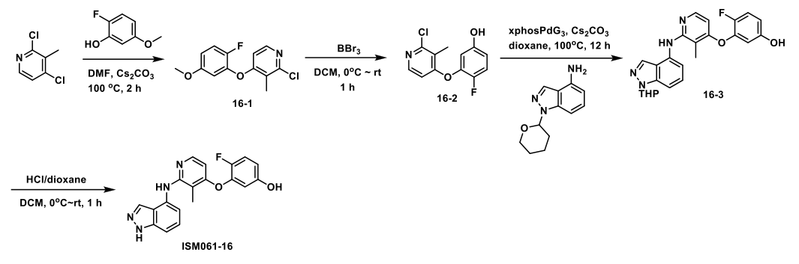

**Scheme S9** Preparation of ISM061-16

#### Step 1: Preparation of Compound 16-1

To a solution of 2,4-dichloro-3-methylpyridine (958 mg, 5.91 mmol) in DMF (10 mL) were added Cs2CO3 (3210 mg, 9.85 mmol) and 2-fluoro-5-methoxyphenol (700 mg, 4.93 mmol). The resulting mixture was stirred at 100 ℃ under N2 atmosphere for 2 hrs. After the addition of water (50 mL), the mixture was extracted with EtOAc (30 mL × 3), the combined organic layers was washed with brine (50 mL), dried over Na2SO4, filtered and concentrated under reduced pressure to give a residue, which was purified by column chromatography on silica gel to afford the title compound (680 mg, 51.9% yield) as a yellow oil. LCMS (ESI+): 267.9 [M+H]+.

#### Step 2: Preparation of Compound 16-2

To a solution of 2-chloro-4-[(2-fluoro-5-methoxyphenyl)oxy]-3-methylpyridine (300 mg, 1.12 mmol) in DCM (3 mL) were added BBr3 (280 mg, 1.12 mmol) at 0 ℃ in N2 atmosphere. The reaction was stirred at 25 ℃ for 1 h. The reaction was quenched with ice water. The aqueous layer was extracted with DCM (30 mL × 3). The combined organic layers was washed with brine (30 mL), dried over Na2SO4, filtered and concentrated under reduced pressure to give a residue, which was purified by column chromatography on silica gel to afford the title compound (100 mg, 35.2%) as a yellow oil. LCMS (ESI+): 254.1 [M+H]+.

#### Step 3: Preparation of Compound 15-3

To a solution of 3-[(2-chloro-3-methylpyridin-4-yl)oxy]-4-fluorophenol (90 mg, 0.35 mmol) in 1,4-dioxane (1 mL) were added 1-(3,4,5,6-tetrahydro-2H-pyran-2-yl)indazol-4-amine (115.6 mg, 0.53 mmol), Cs2CO3 (231 mg, 0.71 mmol), and XantPhosPdG4 (34 mg, 0.04 mmol). The reaction was stirred at 120 ℃ for 10 h in sealed tube. The reaction mixture was poured into ice-water (30 mL) and

<!-- PDF page 25 -->

extracted with DCM (30 mL × 3). The combined organic layers was washed with brine (30 mL), dried over Na2SO4, filtered and concentrated under reduced pressure to give a residue, which was purified by Prep-TLC (SiO2, DCM: MeOH=10: 1) to afford the title compound (100 mg, 64.9%) as a yellow solid. LCMS (ESI+): 435.1 [M+H]+.

#### Step 4: Preparation of ISM061-16

To a solution of **Compound 16-3** (90 mg, 0.21 mmol) in DCM (1 ml) were added HCl (1 mL, 4.00 mmol, 4.0 M in dioxane). After the addition, the reaction mixture was stirred at 25 ℃ for 1 h. Then the mixture was concentrated to afford a crude product, which was further purified with prep-HPLC (column: YMC, C18 (250 × 20mm, 5μm); mobile phase: [water (0.1%NH4OH)- ACN]; B%: 20ACN%-50ACN%, 20min) to afford the title compound (30.28 mg, 41.7%) as a white solid. LCMS (ESI+): 351.1 [M+H]+. 1H NMR (400 MHz, DMSO-d6) δ 12.87 (s, 1H), 9.65 (s, 1H), 8.15 (s, 1H), 7.99 (s, 1H), 7.91 (d, J = 5.6 Hz, 1H), 7.24 (s, 1H), 7.23 (s, 1H), 7.23 - 7.18 (m, 1H), 6.66 - 6.60 (m, 1H), 6.57 (dd, J = 6.8, 2.9 Hz, 1H), 6.26 (d, J = 5.6 Hz, 1H), 2.29 (s, 3H).

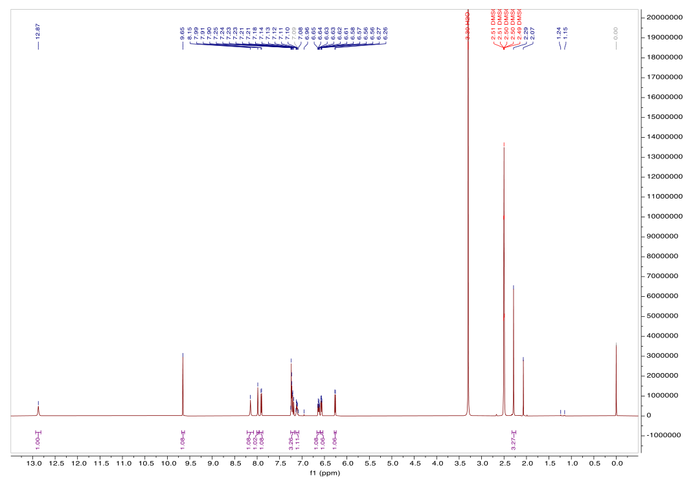

<!-- PDF page 26 -->

### S1.10. Preparation of ISM061-18 and ISM061-18-2

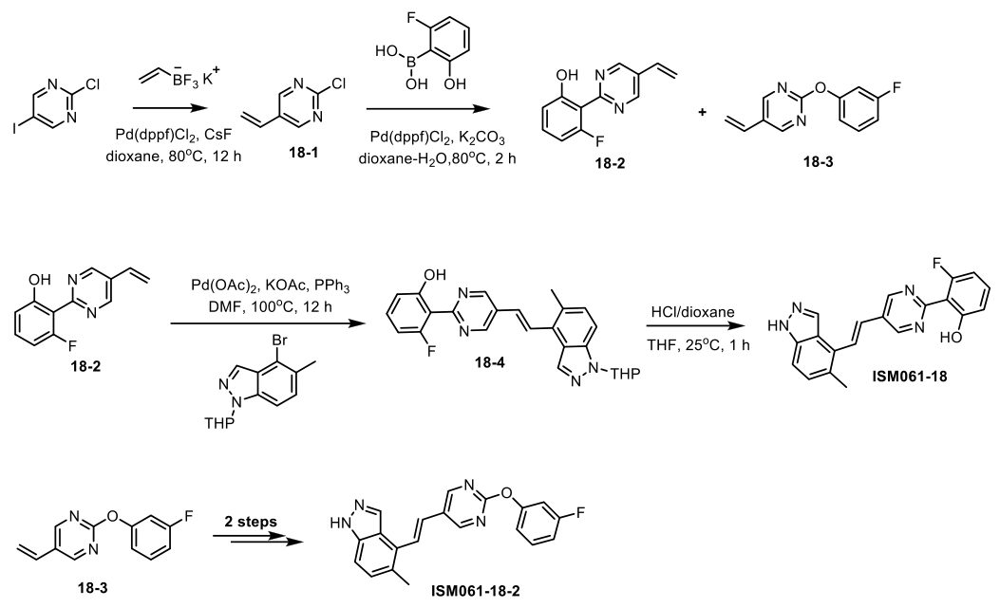

**Scheme S10** Preparation of ISM061-18 and ISM061-18-2

#### Step 1: Preparation of Compound 18-1

To a solution of 2-chloro-5-iodopyrimidine (1.5 g, 6.24 mmol) in 1,4-dioxane (15 mL) was added C2H3BF3K (1.3 g, 9.36 mmol), CsF (1.9 g, 12.48 mmol) and Pd(dppf)Cl2 (0.9 g, 1.25 mmol) at 25 ℃ under N2 atmosphere. After addition, the reaction mixture was heated and stirred at 80 ℃ under a nitrogen atmosphere for 12 h. After cooling to 25 ℃, the reaction mixture was poured into ice water (150 mL) and extracted with EtOAc (70 mL × 3), the combined organic layers were washed with brine (100 mL), dried over Na2SO4, filtered and concentrated under reduced pressure to give a residue, which was purified by column chromatography on silica gel eluting with ethyl acetate (from 0% to 6.4%) in petroleum ether to give the title compound (560 mg, 63.8% yield) as a yellow liquid. LCMS (ESI+): 141.3 [M+H]+.

#### Step 2: Preparation of Compound 18-2 and Compound 18-3

To a solution of 2-chloro-5-vinylpyrimidine (540 mg, 3.84 mmol) in 1,4-dioxane-H2O (6 mL, 5:1) was added K2CO3 (1592 mg, 11.52 mmol), (2-fluoro-6-hydroxyphenyl)boronic acid (1198 mg, 7.68 mmol) and Pd(dppf)Cl2 (562 mg, 0.77 mmol) at 25 ℃ under N2 atmosphere. After addition, the reaction mixture was heated and stirred at 80 ℃ under a nitrogen atmosphere for 12 h. After cooling to 25 ℃, the reaction mixture was poured into ice water (80 mL) and extracted with EtOAc (40 mL × 3), the combined organic layers were washed with brine (60 mL), dried over Na2SO4, filtered and concentrated under reduced pressure to give a residue, which was purified by column chromatography

<!-- PDF page 27 -->

on silica gel eluting with ethyl acetate (from 0% to 22.3%) in petroleum ether to afford **Compound 18-2** (151 mg, 8.6% yield) as a yellow solid; LCMS (ESI+): 217.3 [M+H]+; **Compound 18-3** (400 mg, 22.8%) was obtained as a byproduct of this reaction. LCMS (ESI+): 217.3 [M+H]+;

#### Step 3: Preparation of Compound 18-4

To a solution of **Compound 18-2** (240 mg, 1.11 mmol) in DMF (6 mL) was added KOAc (436 mg, 4.40 mmol), PPh3 (117 mg, 0.45 mmol), 4-bromo-5-methyl-1-(tetrahydro-2H-pyran-2-yl)-1H-indazole (653 mg, 2.20 mmol) and Pd(OAc)2 (101 mg, 0.45 mmol) at 25 ℃ under N2 atmosphere. After addition, the reaction mixture was heated and stirred at 100 ℃ under nitrogen atmosphere for 12 h. After cooling to 25 ℃, the reaction mixture was poured into ice water (80 mL) and extracted with EtOAc (40 mL × 3), the combined organic layers were washed with brine (60 mL), dried over Na2SO4, filtered and concentrated under reduced pressure to give a residue, which was purified by Prep-TLC (SiO2, PE:EA=3: 1) to give the title compound (150 mg, 15.7% yield) as a yellow solid. LCMS (ESI+): 431.1 [M+H]+.

#### Step 4: Preparation of ISM061-18

To a solution of **Compound 18-4** (75 mg, 0.15 mmol) in THF (2 mL) were added HCl (1 mL, 4.00 mmol, 4.0 M in dioxane). After the addition, the reaction mixture was poured into ice water (40 mL) and extracted with DCM (20 mL × 3), the combined organic layers were washed with brine (40 mL), dried over Na2SO4, filtered and concentrated under reduced pressure to give a residue, which was purified by Prep-TLC (SiO2, PE:EA=1: 1) to give ISM023-18 (28.6 mg, 47.4% yield) as a yellow solid. LCMS (ESI+): 347.1 [M+H]+. 1H NMR (400 MHz, DMSO-*d*6) δ 9.30 (s, 2H), 8.47 (s, 1H), 7.91 (d, _J_ = 16.8 Hz, 1H), 7.46 (d, _J_ = 8.4 Hz, 1H), 7.42 – 7.33 (m, 2H), 7.27 (d, _J_ = 8.6 Hz, 1H), 6.83 (d, _J_ = 8.4 Hz, 1H), 6.79 (ddd, _J_ = 10.9, 8.2, 1.1 Hz, 1H), 2.53 (s, 3H).

#### Step 5: Preparation of ISM061-18-2

According to a similar procedure of **ISM061-18**, **ISM023-18-2** was synthesized with ISM061-18-3 as the substrate. LCMS (ESI+): 347.1 [M+H]+. 1H NMR (400 MHz, DMSO-*d*6) δ 9.01 (s, 2H), 8.41 (s, 1H), 7.72 (d, _J_ = 16.7 Hz, 1H), 7.53 – 7.47 (m, 1H), 7.42 (d, _J_ = 8.4 Hz, 1H), 7.29 (d, _J_ = 16.7 Hz, 1H), 7.24 (d, _J_ = 8.5 Hz, 1H), 7.18 (dt, _J_ = 10.1, 2.4 Hz, 1H), 7.16 – 7.08 (m, 2H), 2.49 (s, 3H).

<!-- PDF page 28 -->

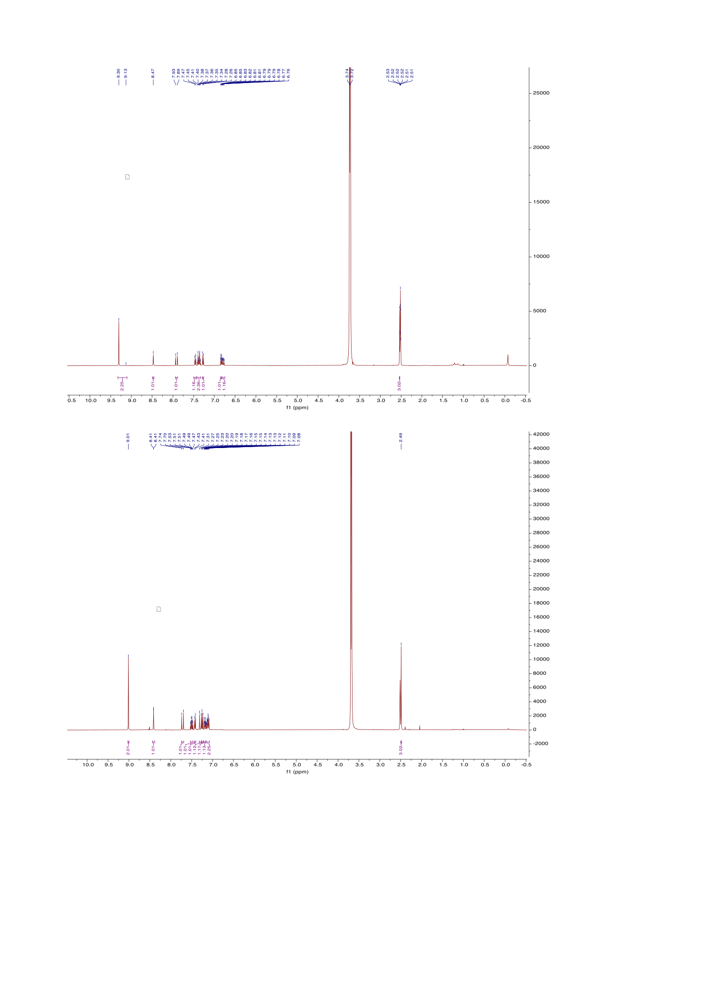

<!-- PDF page 29 -->

### S1.11. Preparation of ISM061-21

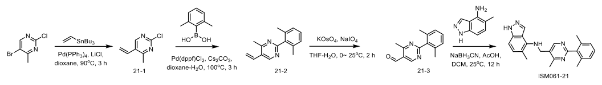

**Scheme S11** Preparation of ISM061-21

#### Step 1: Preparation of Compound 21-1

To a solution of 5-bromo-2-chloro-4-methylpyrimidine (1.00 g, 4.82 mmol) in dioxane (10 mL) and water (2 mL) were added LiCl (600 mg, 14.46 mmol) and tributyl(vinyl)stannane (1.50 g, 4.82 mmol) and Pd(pph3)2Cl2 (300 mg, 0.48 mmol) under N2 atmosphere. Then the mixture was heated and stirred at 100 ℃ for 2 h. After cooling to 25 ℃, the mixture was filtered through a Celite pad. The filtrate was poured into ice water (50 mL) and extracted with EtOAc (40 mL × 3), the combined organic layers were washed with brine (60 mL × 3), dried over Na2SO4, filtered and concentrated under reduced pressure to give a residue, which was purified by column chromatography on silica gel eluting with ethyl acetate (from 0% to 18%) in petroleum ether to afford the title compound (291 mg, 39.1 % yield) as a yellow oil. LCMS (ESI+): 155.3 [M+H]+.

#### Step 2: Preparation of Compound 21-2

To a solution of Compound 21-1 (270 mg, 1.75 mmol), (2,6-dimethylphenyl)boronic acid (265 mg, 1.75 mmol) and Cs2CO3 (1.42 g, 4.37 mmol) in dioxane (10 mL) and Water (2 mL) was added Pd(dppf)Cl2 (128 mg, 0.17 mmol) at 25 ℃. After addition, the mixture was heated and stirred at 100 ℃ under a nitrogen atmosphere for 2 h. After cooling to 25 ℃, the reaction mixture was poured into water (100 mL) and extracted with EtOAc (50 mL × 3). The combined organic layers was washed with brine (60 mL), dried over Na2SO4, filtered and concentrated under reduced pressure to give a residue, which was purified by Prep-TLC (SiO2, PE : EA=3: 1) to afford the title compound (150 mg, 38.3% yield) as a yellow oil. LCMS (ESI+): 225.3 [M+H]+.

#### Step 3: Preparation of Compound 21-3

To a solution of 2-(2,6-dimethylphenyl)-4-methyl-5-vinylpyrimidine (130 mg, 0.58 mmol) and NaIO4 (372 mg, 1.74 mmol) in THF (2.5 mL) and H2O (2.5 mL) were added KOsO4 (26.7 mg, 0.058 mmol) at 0 ℃. Then the mixture was heated and stirred at 25 ℃ for 0.5 h. The reaction mixture was poured into ice water (30 mL) and extracted with EtOAc (15 mL × 3), the combined organic layers were washed with brine (30 mL), dried over Na2SO4, filtered and concentrated under reduced pressure to give a residue, which was purified by Prep-TLC (SiO2, PE:EA=5: 1) to afford the title compound (123 mg, 93.8% yield) as a yellow oil. LC-MS (ESI+): 227.3 [M+H]+.

<!-- PDF page 30 -->

#### Step 4: Preparation of ISM061-21

To a solution of **compound 21-3** (10 mg, 0.04 mmol) in DCM (1 mL) were added 5-methyl-1H-indazol-4-amine (7.2 mg, 0.05 mmol), Titanium tetraisopropanolate (37 mg, 0.13 mmol). The reaction mixture was stirred at 25 ℃ for 12 h. After the addition of NaBH3CN (5.5 mg, 0.09 mmol), the mixture was further stirred at 25 ℃ for 2 hr. The reaction mixture was filtered and concentrated under reduced pressure to give a residue, which was purified by Prep-HPLC to afford the title compound (1.14 mg, 7.2% yield). LCMS (ESI+): 358.3 [M+H]+; 1H NMR (400 MHz, DMSO-*d*6) δ 12.64 (s, 1H), 8.60 (s, 1H), 7.86 (s, 1H), 7.27 – 7.17 (m, 1H), 7.13 – 7.08 (m, 2H), 7.05 (d, _J_ = 8.3 Hz, 1H), 6.74 (d, _J_ = 8.2 Hz, 1H), 5.65 (t, _J_ = 6.3 Hz, 1H), 4.85 (d, _J_ = 6.1 Hz, 2H), 2.61 (s, 3H), 2.26 (s, 3H), 1.95 (s, 6H).

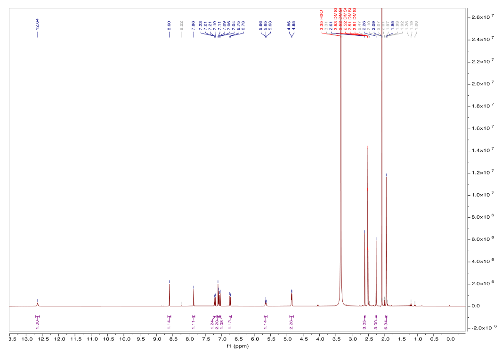

### S1.9. Preparation of ISM061-22

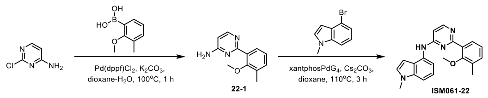

**Scheme S8** Preparation of ISM061-22

<!-- PDF page 31 -->

#### Step 1: Preparation of Compound 22-1

To a solution of 2-chloropyrimidin-4-amine (130 mg, 1.00 mmol) in dioxane (3 mL) were added H2O (0.2 mL), (2-methoxy-3-methylphenyl)boronic acid (183 mg, 1.10 mmol), Pd(dppf)Cl2 (73 mg, 0.10 mmol) and K2CO3 (347 mg, 2.50 mmol) under N2 atmosphere. Then the mixture was heated and stirred at 100 ℃ for 1 h. After cooling to 25 ℃, the reaction mixture was poured into ice water (40 mL) and extracted with EtOAc (40 mL × 3), the combined organic layers were washed with brine (30 mL × 3), dried over Na2SO4, filtered and concentrated under reduced pressure to give a residue, which was purified by column chromatography on silica gel eluting with ethyl acetate (from 0% to 50%) in petroleum ether to give the title compound (200 mg, 64.8% yield, purity: 70%) as a yellow oil. LCMS (ESI+): 216.1 [M+H]+.

#### Step 2: Preparation of ISM061-22

To a solution of 2-(2-methoxy-3-methylphenyl)pyrimidin-4-amine (161 mg, 0.52 mmol, purity: 70%) in dioxane (4 mL) were added 4-bromo-1-methyl-1H-indole (100 mg, 0.47 mmol), XantphosPdG4 (77 mg, 0.05 mmol) and Cs2CO3 (310 mg, 0.95 mmol) under N2 atmosphere. Then the mixture was heated and stirred at 110 ℃ for 3 h. After cooling to 25 ℃, the reaction mixture was poured into ice water (40 mL) and extracted with EtOAc (40 mL × 3), the combined organic layers were washed with brine (30 mL × 3), dried over Na2SO4, filtered and concentrated under reduced pressure to give a residue, which was purified by column chromatography on silica gel eluting with ethyl acetate (from 0% to 60%) in petroleum ether and Prep-HPLC (column: YMC, C18 (250 × 20mm, 5μm); mobile phase: [water (0.1%NH4HCO3)- ACN]; B%: 30ACN%-60ACN%, 17 min of 25 min) to afford the title compound (70 mg, 42.7% yield) as a white solid. LCMS (ESI+): 345.1 [M+H]+. 1H NMR (400 MHz, DMSO-*d*6) δ 9.36 (s, 1H), 8.34 (d, _J_ = 5.9 Hz, 1H), 7.65 (d, _J_ = 7.6 Hz, 1H), 7.44 (d, _J_ = 5.9 Hz, 1H), 7.35 – 7.25 (m, 2H), 7.19 (d, _J_ = 8.1 Hz, 1H), 7.09 (dt, _J_ = 11.3, 7.7 Hz, 2H), 6.81 (d, _J_ = 5.9 Hz, 1H), 6.61 (d, _J_ = 3.1 Hz, 1H), 3.79 (s, 3H), 3.60 (s, 3H), 2.28 (s, 3H).

<!-- PDF page 32 -->

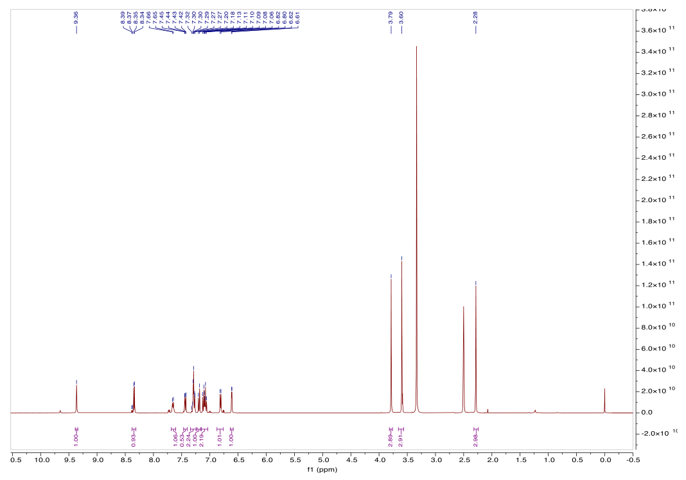

### S1.12. Preparation of ISM061-24

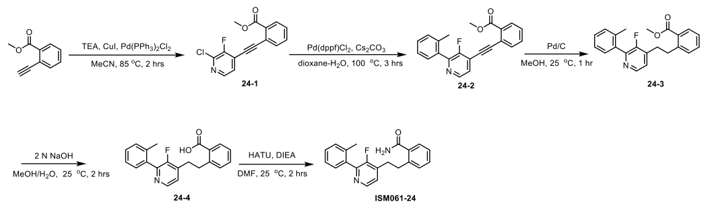

**Scheme S12** Preparation of ISM061-24

#### Step 1: Preparation of Compound 24-1

To a solution of methyl 2-ethynylbenzoate (600.0 mg, 3.79 mmol), 2-chloro-3-fluoro-4-iodopyridine (1171.5 mg, 4.55 mmol) in MeCN (3 mL) were added TEA (1.6 mL, 11.38 mmol), CuI (144.5 mg, 0.76 mmol) and Pd(PPh3)2Cl2 (266.2 mg, 0.38 mmol). After addition, the mixture was degassed and purged with N2 for 2 mins and then stirred at 85 ℃ for 2 hrs. After cooling to 20 ℃, the reaction solution was poured into water (50 mL) and extracted with EtOAc (25 mL × 3). The combined organic layers were washed with brine (25 mL × 2), dried over Na2SO4, filtered and concentrated under reduced pressure to give a residue. The residue was purified by flash silica gel chromatography (SiO2,

<!-- PDF page 33 -->

ethyl acetate: petroleum ether = 0% - 6%) to afford **Compound 24-1** (700 mg, 64% yield) as a white solid. LCMS (ESI+): 290.2 [M+H]+.

#### Step 2: Preparation of Compound 24-2

To a solution of methyl 2-((2-chloro-3-fluoropyridin-4-yl)ethynyl)benzoate (650.0 mg, 2.24 mmol) in dioxane/water (6 mL, 5: 1) were added _o_-tolylboronic acid (366.2 mg, 2.69 mmol), Cs2CO3 (2193.0 mg, 6.73 mmol) and Pd(dppf)Cl2 (164.2 mg, 0.22 mmol). After addition, the mixture was degassed and purged with N2 for 2 mins and then stirred at 100 ℃ for 3 hrs. After cooling to 20 ℃, the reaction solution was poured into water (50 mL) and extracted with EtOAc (25 mL × 3). The combined organic layers were washed with brine (25 mL × 2), dried over Na2SO4, filtered and concentrated under reduced pressure to give a residue. The residue was purified by flash silica gel chromatography (SiO2, ethyl acetate: petroleum ether = 0% - 10%) to afford **Compound 24-2** (600 mg, 77% yield) as colorless oil. LCMS(ESI+): 346.2 [M+H]+. 1H NMR (400 MHz, DMSO-d6) δ 8.59 - 8.57 (m, 1H), 8.00 - 7.97 (m, 1H), 7.80 - 7.78 (m, 1H), 7.73 - 7.60 (m, 3H), 7.42 - 7.30 (m, 4H), 3.88 (d, J = 4.0 Hz, 3H), 2.20 (s, 3H).

#### Step 3: Preparation of Compound 24-3

To a solution of methyl 2-((3-fluoro-2-(o-tolyl)pyridin-4-yl)ethynyl)benzoate (500.0 mg, 1.45 mmol) in MeOH (5 mL) was added wet Pd/C (77.0 mg, 10%). After addition, the mixture was degassed and purged with H2 for 3 times and then the mixture was stirred at 25 ℃ for 1 hr under H2 atmosphere (15Psi). The reaction mixture was filtered through a celite and the filter cake was rinsed with a small amount of MeOH (50 mL). The combined organic layers were concentrated under reduced pressure to afford **Compound 24-3** (400 mg), which was used in next step directly without further purification. LCMS (ESI+): 350.1 [M+H]+.

#### Step 4: Preparation of Compound 24-4

To a solution of methyl 2-(2-(3-fluoro-2-(o-tolyl)pyridin-4-yl)ethyl)benzoate (100.0 mg, 0.29 mmol) in MeOH (3 mL) and water (3 mL) was added 2 N NaOH (0.7 mL, 1.43 mmol) and then the reaction was stirred at 25 ℃ for 2 hrs. The reaction mixture was poured into 20 mL of ice-water carefully and the aqueous phase was washed with EtOAc (20 mL × 2) and adjust pH = 9 with 1 N HCl. The resulting solution was extracted with EtOAc (20 mL × 2). The combined organic layers were washed with brine (20 mL × 2), dried over Na2SO4, filtered and concentrated under reduced pressure to afford **Compound 24-4** (90 mg), which was used in next step directly without further purification. LCMS(ESI+): 336.3 [M+H]+.

<!-- PDF page 34 -->

#### Step 5: Preparation of ISM061-24

To a solution of 2-(2-(3-fluoro-2-(o-tolyl)pyridin-4-yl)ethyl)benzoic acid (70.0 mg, 0.21 mmol) in DMF (2 mL) were added ammonium chloride (11.2 mg, 0.21 mmol), HATU (87.3 mg, 0.23 mmol) and DIEA (0.1 mL, 0.42 mmol) and then the reaction mixture was stirred at 25 ℃ for 2 hrs. The reaction solution was poured into water (50 mL) and extracted with EtOAc (25 mL × 3). The combined organic layers were washed with brine (20 mL × 2), dried over Na2SO4, filtered and concentrated under reduced pressure to give a residue. The residue was purified by prep-TLC (SiO2, ethyl acetate: petroleum ether = 1: 1) to afford **ISM061-24** (30 mg, 43% yield) as a white solid. LCMS(ESI+): 335.3 [M+H]+. 1H NMR (400 MHz, DMSO-*d*6) δ 8.37 (d, _J_ = 4.9 Hz, 1H), 7.80 (s, 1H), 7.41 – 7.20 (m, 10H), 3.14 – 3.06 (m, 2H), 3.04 – 2.97 (m, 2H), 2.13 (s, 3H).

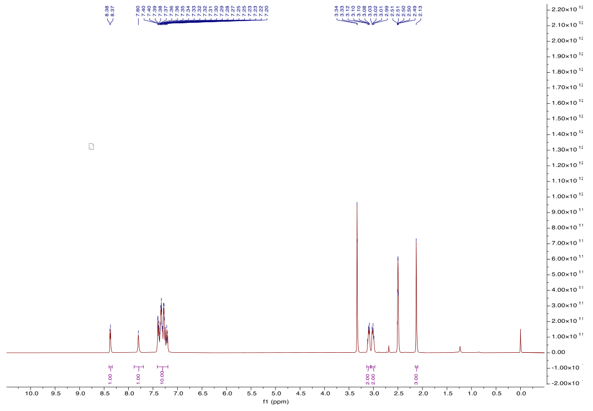

### S1.13. Preparation of ISM061-24-2

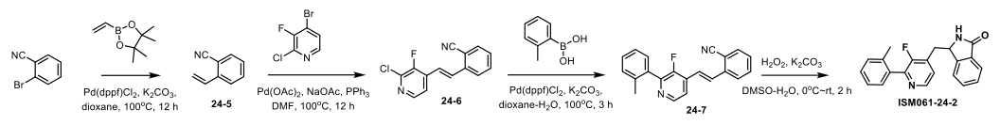

**Scheme S13** Preparation of ISM061-24-2

#### Step 1: Preparation of Compound 24-5

To a solution of 2-bromobenzonitrile (2 g, 10.99 mmol) in 1,4-dioxane-H2O (24 mL,5:1) was added 4,4,5,5-tetramethyl-2-vinyl-1,3,2-dioxaborolane (2.5 g, 16.48 mmol), K2CO3 (3 g, 21.98 mmol) and

<!-- PDF page 35 -->

Pd(dppf)Cl2 (804 mg, 1.10 mmol) at 25 ℃ under N2 atmosphere. After addition, the reaction mixture was heated and stirred at 100 ℃ under a nitrogen atmosphere for 12 h. After cooling to 25 ℃, the reaction mixture was poured into ice water (200 mL) and extracted with EtOAc (100 mL × 3), the combined organic layers were washed with brine (150 mL), dried over Na2SO4, filtered and concentrated under reduced pressure to give a residue, which was purified by column chromatography on silica gel eluting with ethyl acetate (from 0% to 6.8%) in petroleum ether to give the title compound (1.2 g, 84.5% yield) as a yellow liquid.

#### Step 2: Preparation of Compound 24-6

To a solution of 2-vinylbenzonitrile (500 mg, 3.87 mmol) in DMF (5 mL) was added KOAc (759 mg, 7.74 mmol), PPh3 (203 mg, 0.77 mmol), 4-bromo-2-chloro-3-fluoropyridine (896 mg, 4.26 mmol) and Pd(OAc)2 (175 mg, 0.77 mmol) at 25 ℃ under N2 atmosphere. After addition, the reaction mixture was heated and stirred at 100 ℃ under a nitrogen atmosphere for 4 h. After cooling to 25 ℃, the reaction mixture was poured into ice water (80 mL) and extracted with EtOAc (40 mL × 3), the combined organic layers were washed with brine (80 mL), dried over Na2SO4, filtered and concentrated under reduced pressure to give a residue, which was purified by Prep-TLC (SiO2, PE:EA=4: 1) to give the title compound (320 mg, 32.0% yield) as a white solid. LCMS (ESI+): .259.0 [M+H]+.

#### Step 3: Preparation of Compound 24-7

To a solution of **Compound 24-6** (250 mg, 0.97 mmol), o-tolylboronic acid (197 mg, 1.75 mmol) and K2CO3 (266 mg, 1.92 mmol) in dioxane (5 mL) and water (1 mL) was added Pd(dppf)Cl2 (70 mg, 0.09 mmol) at 25 ℃. After addition, the mixture was heated and stirred at 100 ℃ under a nitrogen atmosphere for 1 h. After cooling to 25 ℃, the reaction mixture was poured into water (100 mL) and extracted with EtOAc (50 mL × 3), washed with brine (60 mL). The organic layer was dried over Na2SO4, filtered and concentrated under reduced pressure to give a residue, which was purified by Prep-TLC (SiO2, PE:EA=3: 1) to afford the title compound (300 mg, 98.7% yield) as a yellow soild. LCMS (ESI+): 315.2 [M+H]+.

#### Step 4: Preparation of ISM061-24-2

To a solution of **Compound 24-7** (250 mg, 0.79 mmol) and K2CO3 (330 mg, 2.38 mmol) in DMSO (5 mL) and Water (3 mL) was added H2O2 (5 mL, 30%wt in water) dropwise at 0 ℃. After addition, the mixture was heated and stirred at 25 ℃ for 2 h. The reaction mixture was poured into water (50 mL) and extracted with EtOAc (30 mL × 3). The combined organic layers was washed with brine (30 mL), dried over Na2SO4, filtered and concentrated under reduced pressure to give a residue, which was purified by column chromatography on silica gel eluting with ethyl acetate (from 0% to 100%) in petroleum ether to give the title compound (240 mg, 90.8% yield) as a yellow soild. LCMS (ESI+):

<!-- PDF page 36 -->

333.3 [M+H]+. 1H NMR (400 MHz, DMSO-*d*6) δ 8.77 (s, 1H), 8.32 (d, _J_ = 4.8 Hz, 1H), 7.62 – 7.52 (m, 3H), 7.45 (ddd, _J_ = 8.0, 5.8, 2.3 Hz, 1H), 7.36 – 7.24 (m, 4H), 7.20 – 7.16 (m, 1H), 5.04 (t, _J_ = 5.5 Hz, 1H), 3.26 (d, _J_ = 5.5 Hz, 2H), 1.95 (s, 3H).

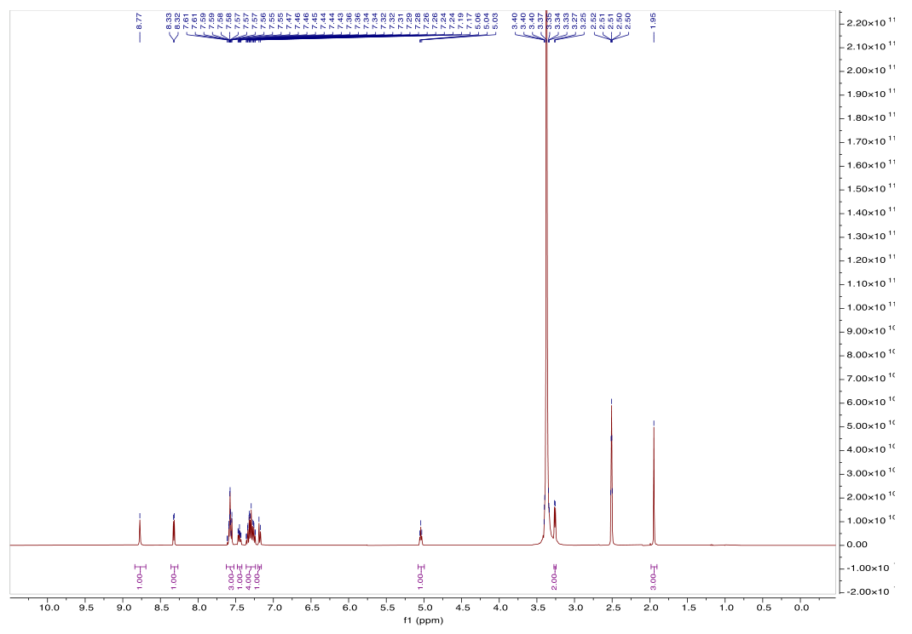

<!-- PDF page 37 -->

## S3. Surface Plasmon Resonance Affinity Measurements

In all experiments, the Biacore 8K system was used. For preliminary compound screening, N-terminal biotinylated KRAS G12D protein (synthesized by VIVA Biotech (Shanghai) Ltd, purity ≥ 95%) was captured on a Sensor Chip SA (GE Healthcare) at a density of about 2000RU. Protein immobilization was done using 1x HBS-EP+, 2 mM TCEP, 2% DMSO as running buffer. Protein was injected for 70 s at a flow rate of 5 μL/min. The protein concentration was 5 μg/mL. The samples for initial screening of the compounds were prepared by serial two-fold dilutions from 200 μM to 0.39 μM in 1x HBS-EP+, 2mM TCEP, 2% DMSO. Samples were injected for 60 s at a flow rate of 30 μL/min and the dissociation time was 180 s. Biacore 8K software was used for data analysis.

In order to validate the setup, the reference ligands MRTX1133 and BI-2852 where synthesized and tested. It was found that these two compounds exhibit a “slow off” dissociation feature (Figure S1). Their binding parameters (including the dissociation constant _Kd_) are listed in Table 2.

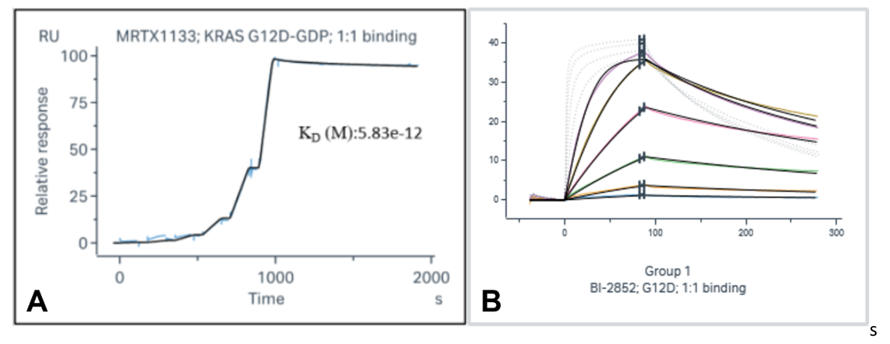

**Figure S1**. SPR experiments for the reference compounds. A) Response curve of MRTX1133 in single cycle mode. B) Response curve of BI-2852 in multiple cycle mode. MRTX1133 was too active to allow determination of Kd by the multiple cycling mode.

For 5 out of 12 newly generated and synthesized compounds, reasonable (micromolar) affinity was found (Table 3) along with the “fast off” kinetic behavior (Figure S2).

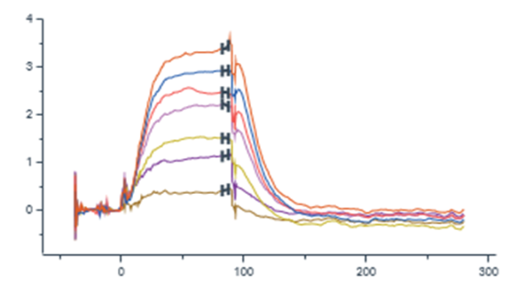

**Figure S2.** SPR response curves for multiple cycle mode experiments for ISM061-18-2.
